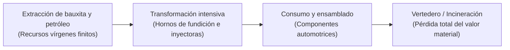
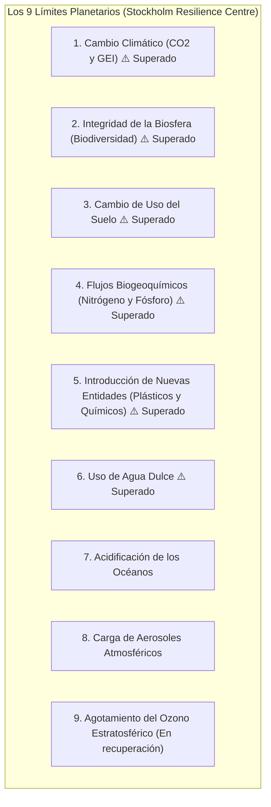
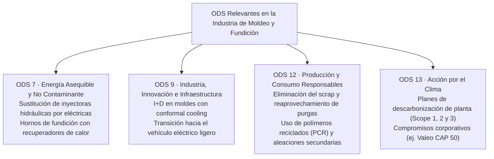
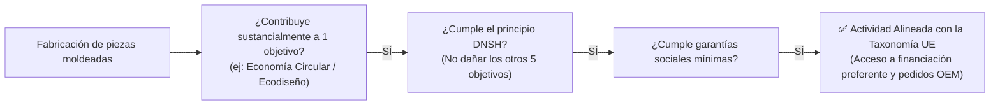

# Unidad 01 · Fundamentos de la sostenibilidad y marcos internacionales

<span class="badge badge-ra">RA1 · Criterios a, c</span>
<span class="badge badge-polimero">Polímeros y Plásticos</span>
<span class="badge badge-metal">Fundición y Metalurgia</span>
<span class="badge badge-valeo">Sector Industrial Martos</span>

Para un futuro **Técnico Superior en Programación de la Producción en Moldeo de Metales y Polímeros**, la sostenibilidad ha dejado de ser un concepto abstracto o un mero eslogan publicitario. En la actualidad, constituye el eje central que determina la viabilidad económica, legal y técnica de una fábrica de inyección de piezas plásticas o de fundición inyectada de aluminio y zamak.

Tanto si se trabaja en un gran fabricante de componentes de automoción como **Valeo Iluminación Martos**, en un centro tecnológico de referencia como **Andaltec**, o en una empresa auxiliar de matricería y moldeo, la industria manufacturera opera bajo una presión regulatoria y de mercado sin precedentes para descarbonizar sus procesos y transitar hacia modelos circulares.

---

## 1. El concepto de desarrollo sostenible y los límites del planeta

### 1.1 Del Informe Brundtland a la crisis ecológica actual

La definición universalmente aceptada de desarrollo sostenible procede del informe *«Nuestro Futuro Común»* (Comisión Brundtland, 1987, ONU):

> *«El desarrollo sostenible es aquel que satisface las necesidades de la generación presente sin comprometer la capacidad de las generaciones futuras para satisfacer sus propias necesidades.»*

Históricamente, la revolución industrial y el despegue de la industria de los polímeros sintéticos (a partir de la década de 1950) y de la fundición masiva de metales ligeros operaron bajo un modelo de **economía lineal tradicional** basado en la premisa errónea de recursos infinitos y capacidad ilimitada de la atmósfera y los océanos para absorber residuos y emisiones:



### 1.2 El marco de los Límites Planetarios (*Planetary Boundaries*)

Desarrollado en 2009 por el *Stockholm Resilience Centre* (liderado por Johan Rockström), este marco científico establece los **nueve procesos biofísicos críticos** que regulan la estabilidad del sistema Tierra. Superar estos umbrales aumenta el riesgo de generar cambios ambientales abruptos e irreversibles.



#### Impacto directo en la industria de moldeo de metales y polímeros:
Límite 5: Nuevas Entidades (*Novel Entities*)
: Comprende las sustancias sintéticas creadas por el ser humano, incluidos los plásticos y microplásticos. En 2022, la comunidad científica determinó formalmente que este límite ha sido superado, ya que la velocidad de producción y liberación de polímeros supera con creces la capacidad global de control, reciclaje y evaluación toxicológica.

Límite 1: Cambio Climático
: La producción de aluminio primario a partir de bauxita en hornos de electrólisis y la síntesis petroquímica de polímeros vírgenes (policarbonato, poliamidas, polipropileno) demandan volúmenes masivos de energía fósil, liberando gigatoneladas de gases de efecto invernadero (GEI).

---

## 2. Marcos internacionales y compromisos globales

### 2.1 El Acuerdo de París (2015) y la neutralidad climática

El **Acuerdo de París** (COP21) estableció el objetivo jurídicamente vinculante de mantener el aumento de la temperatura media mundial **muy por debajo de 2 °C** con respecto a los niveles preindustriales, y proseguir los esfuerzos para limitarlo a **1,5 °C**.

Para el sector de fabricación mecánica y transformación de materiales, esto implica alcanzar la **neutralidad de emisiones netas de carbono (Net Zero) en el año 2050**, con objetivos intermedios draconianos de reducción del 55% de emisiones para 2030 (*Fit for 55* en la Unión Europea).

### 2.2 La Agenda 2030 y los Objetivos de Desarrollo Sostenible (ODS)

Aprobados por la Asamblea General de la ONU en septiembre de 2015, los **17 Objetivos de Desarrollo Sostenible (ODS)** y sus 169 metas proporcionan una hoja de ruta común para gobiernos, sociedad y empresas.



| ODS | Meta específica | Aplicación en la planta de moldeo de Martos |
|---|---|---|
| **ODS 7** | **7.3** Duplicar la tasa de eficiencia energética. | Auditoría del consumo eléctrico por kilo de polímero inyectado ($\text{kWh/kg}$). Aislamiento térmico de cilindros calefactores y optimización del atemperado de moldes. |
| **ODS 9** | **9.4** Modernizar la infraestructura y reconvertir industrias para que sean sostenibles. | Introducción de fabricación aditiva metálica (DMLS) para canales de refrigeración adaptada en moldes de inyección, reduciendo el tiempo de ciclo en un 25%. |
| **ODS 12** | **12.5** Reducir considerablemente la generación de desechos mediante actividades de prevención, reducción, reciclado y reutilización. | Implementación de sistemas de circuito cerrado para el triturado in situ de coladas frías y reincorporación dosificada de granza reciclada sin merma de propiedades ópticas o mecánicas. |
| **ODS 13** | **13.2** Incorporar medidas relativas al cambio climático en las políticas empresariales. | Cálculo riguroso de la huella de carbono de producto requerida por los fabricantes automotrices (Renault, Stellantis, BMW) para adjudicar nuevos proyectos de faros y proyectores. |

---

## 3. El marco europeo: Pacto Verde Europeo y Taxonomía Ambiental

La Unión Europea lidera la legislación ambiental global a través del **Pacto Verde Europeo (*European Green Deal*)**, cuyo propósito es convertir a Europa en el primer continente climáticamente neutro para 2050, transformando los desafíos ecológicos en oportunidades industriales.

### 3.1 La Taxonomía de la Unión Europea (Reglamento UE 2020/852)

La Taxonomía es un sistema de clasificación científica que define con precisión **qué actividades económicas son medioambientalmente sostenibles**. Para que una actividad de fabricación de plásticos o piezas metálicas sea considerada taxonómicamente verde por bancos e inversores, debe cumplir tres condiciones:

1. Contribuir sustancialmente a al menos uno de los **seis objetivos ambientales de la UE**:
   - Mitigación del cambio climático.
   - Adaptación al cambio climático.
   - Uso sostenible y protección de los recursos hídricos y marinos.
   - Transición hacia una **economía circular**.
   - Prevención y control de la contaminación.
   - Protección y restauración de la biodiversidad y los ecosistemas.
2. **No causar un perjuicio significativo (*Do No Significant Harm - DNSH*)** a ninguno de los otros cinco objetivos.
3. Cumplir con garantías sociales mínimas (convenios de la OIT y derechos laborales).



---

## 4. El papel del Técnico de Programación de la Producción

En el organigrama de una factoría de moldeo, el **Técnico Superior en Programación de la Producción** ocupa una posición estratégica intermedia entre el departamento de ingeniería de producto/calidad y los operarios de máquina:

```text title="responsabilidades-sostenibilidad.txt"
Ingeniería / I+D (Ecodiseño) ──► Define la pieza y el material (PC, PMMA, Zamak)
           │
           ▼
TÉCNICO DE PROGRAMACIÓN      ──► AJUSTA EL PROCESO REAL EN PLANTA:
           │                      * Minimiza tiempo de ciclo y consumo eléctrico
           │                      * Ajusta perfiles térmicos y presiones para cero defectos
           │                      * Controla la reincorporación de mazarotas y purgas
           │                      * Gestiona la lubricación y mantenimiento del molde
           ▼
Operarios / Línea de Montaje ──► Ejecución productiva continua sin paradas innecesarias
```

!!! tip "Claves de examen: Eficiencia energética en moldeo"

    El parámetro clave de eficiencia en una planta de inyección de plástico o fundición a alta presión es el **consumo específico de energía**:
    $$\text{Consumo Específico} = \frac{\text{Consumo Eléctrico Total (kWh)}}{\text{Masa de Piezas Conformes Producidas (kg)}}$$
    Un técnico competente no solo busca "sacar piezas rápido", sino minimizar el $\text{kWh/kg}$ evitando rebabas, rechupados o degradación térmica del polímero.

!!! warning "Error común en taller"

    Pensar que el material que se tira a la cuba de purga "no cuesta nada porque se tritura". 
    El material purgado ha consumido horas de deshumidificación, calor de plastificación y horas de máquina. Además, el triturado sucesivo degrada la longitud de cadena polimérica, reduciendo la viscosidad y comprometiendo la resistencia al impacto de la pieza final.
