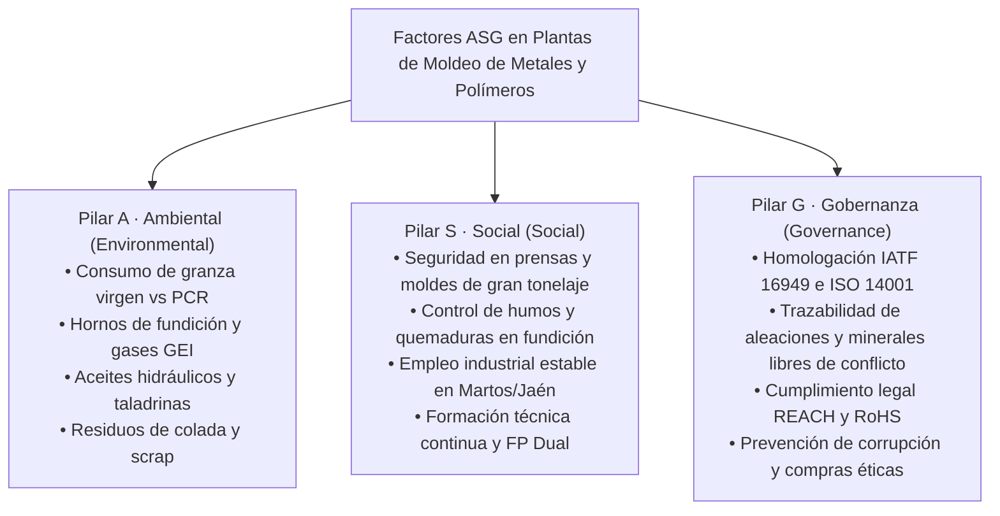
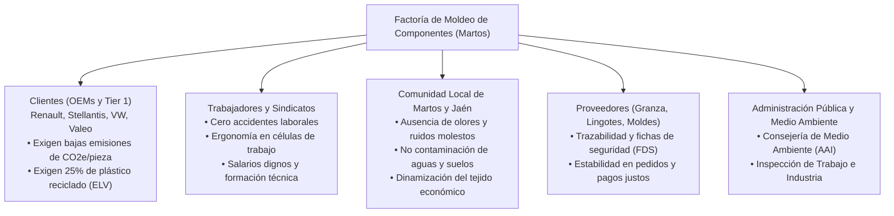
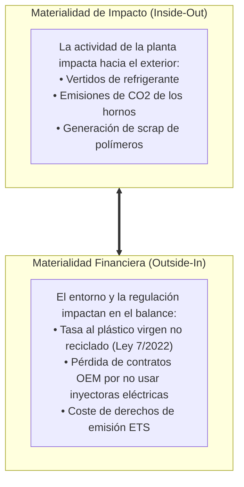

# Unidad 02 · Aspectos ASG y grupos de interés en plantas de moldeo

RA1 · Criterios b, d
Gestión ASG en Plásticos
Gestión ASG en Fundición
Cadena de Suministro Automoción

En el entorno industrial contemporáneo, el éxito de una planta productiva no se mide únicamente por sus estados contables o su volumen de piezas por turno. Las grandes corporaciones y los fondos de inversión evalúan a las empresas mediante criterios **ASG (Ambientales, Sociales y de Gobernanza)** —conocidos internacionalmente como criterios **ESG (*Environmental, Social and Governance*)**.

Para el sector del moldeo de metales y polímeros en **Martos y su comarca**, los criterios ASG han pasado a ser una condición contractual indispensable: los fabricantes de vehículos (como Stellantis, Renault, Grupo Volkswagen o BMW) exigen a sus proveedores Tier 1 (como **Valeo**) y a los talleres auxiliares de matricería y fundición auditorías rigurosas de desempeño ASG como requisito previo a la adjudicación de cualquier pedido.

---

## 1. Los tres pilares ASG en la industria de moldeo

### 1.1 Pilar Ambiental (*Environmental*)
Abarca el impacto directo e indirecto de las operaciones de moldeo sobre el entorno natural:
- **Consumo de materias primas y circularidad:** Proporción de granza plástica virgen de origen petroquímico frente a termoplásticos reciclados post-consumo (PCR) o bio-basados. En metales, uso de lingote de aluminio secundario (reciclado) frente a aluminio primario de alta huella de carbono.
- **Eficiencia energética y emisiones de gases de efecto invernadero (GEI):** Consumo de gas natural o electricidad en hornos de fusión de crisol (aluminio a 680-720 °C, zamak a 420 °C). Electricidad consumida por motores hidráulicos de inyectoras, husillos calefactores, enfriadoras de agua (*chillers*) y deshumidificadores de polímeros higroscópicos (como poliamidas o policarbonatos).
- **Emisiones a la atmósfera y calidad del aire interior:** Emisiones fugitivas de compuestos orgánicos volátiles (VOCs) generados por desmoldeantes en spray, barnices de protección UV para ópticas de faros, y nieblas de aceite procedentes de prensas y fluidos de corte en talleres de matricería.
- **Gestión de residuos peligrosos:** Lodos de mecanizado, taladrinas agotadas, aceites hidráulicos degradados, escorias de fundición (*dross*) y filtros saturados.

### 1.2 Pilar Social (*Social*)
Gestiona la relación de la empresa con las personas, tanto dentro de sus instalaciones como en la comunidad local:
- **Seguridad y Salud en el Trabajo (PRL):** 
  - Protección frente a riesgos mecánicos graves en prensas de inyección de alto tonelaje (fuerzas de cierre de 500 a 3.000 toneladas): barreras inmateriales fotoeléctricas, dobles mandos y cerrojos hidráulicos de seguridad.
  - Riesgos térmicos: salpicaduras de metal fundido en fundición inyectada (HPDC), quemaduras por contacto con boquillas y moldes calientes (hasta 180 °C en inyección de plásticos técnicos).
  - Exposición higiénica a humos de degradación de polímeros (formaldehído en POM, estireno en ABS) y polvos de esmerilado de moldes.
- **Impacto socioeconómico en la comarca de Martos:** Generación de empleo industrial cualificado y estable en Jaén, reduciendo la emigración juvenil y diversificando la economía más allá del sector olivarero tradicional.
- **Formación y atracción de talento:** Apoyo decidido a la **FP Dual** en colaboración con los centros educativos comarcales.

### 1.3 Pilar de Gobernanza (*Governance*)
Refleja cómo se gobierna y audita la organización industrial:
- **Sistemas de gestión certificados:** Certificación bajo la norma internacional del sector automotriz **IATF 16949**, junto con **ISO 14001** (medio ambiente) e **ISO 50001** (gestión de la energía).
- **Cadena de suministro y debida diligencia:** Trazabilidad estricta del origen de las aleaciones metálicas (evitando minerales de zonas de conflicto según la legislación europea sobre estaño, tantalio, tungsteno y oro) y cumplimiento del reglamento químico **REACH** (Reglamento CE 1907/2006) y directiva **RoHS** (restricción de sustancias peligrosas como plomo, cadmio o mercurio).
- **Ética empresarial y transparencia:** Canales éticos de denuncia, políticas anticorrupción y reporte transparente de no conformidades y scrap de planta.

---

## 2. Grupos de interés (*Stakeholders*) en el polo industrial

Los **grupos de interés** son cualquier individuo o colectivo que puede afectar o verse afectado por las decisiones y actividades de la planta de fabricación:

---

## 3. Matriz de Doble Materialidad (Directiva CSRD)

La nueva Directiva europea de Información sobre Sostenibilidad Sostenible (**CSRD**, Directiva UE 2022/2464) introduce el principio de **Doble Materialidad**, el cual exige que las industrias analicen los asuntos ASG desde dos perspectivas inseparables:

1. **Materialidad de Impacto (*Inside-Out*):** ¿Cómo impacta la actividad de la fábrica en el medio ambiente y en la sociedad? (ej: los humos de fundición o el vertido de microplásticos en las aguas de limpieza).
2. **Materialidad Financiera (*Outside-In*):** ¿Cómo impactan los riesgos climáticos y sociales en la cuenta de resultados de la empresa? (ej: el encarecimiento de la factura eléctrica por subida del precio del gas para los hornos, o multas por superar los límites de emisiones de la Autorización Ambiental Integrada).

### 3.1 Ejemplo de Matriz de Materialidad para una planta de inyección y fundición

| Asunto ASG identificado | Impacto en el entorno (*Inside-Out*) | Riesgo / Oportunidad Financiera (*Outside-In*) | Nivel de Prioridad |
|---|---|---|:---:|
| **Eficiencia energética de prensas y hornos** | Alto (Reducción de consumo de combustibles y electricidad de red). | Crítico (El coste energético supone hasta el 18-25% del coste total de inyección). | **Muy Alta** |
| **Incorporación de granza reciclada (PCR)** | Alto (Disminución de demanda de polímero fósil virgen). | Alto (Cumplimiento de cuota obligatoria de automoción y ahorro del impuesto de 0,45 €/kg al plástico no reciclado). | **Muy Alta** |
| **Seguridad de operarios en moldes pesados** | Crítico (Protección de la integridad física de las personas). | Alto (Costes de paralización de línea, sanciones de la ITSS y primas de seguros). | **Muy Alta** |
| **Reaprovechamiento de coladas y mazarotas** | Medio (Reducción de residuos industriales). | Medio-Alto (Recuperación directa de material valorizable en planta). | **Alta** |
| **Gestión de taladrinas y fluidos de matricería** | Medio (Evita contaminación de acuíferos locales). | Medio (Cumplimiento de autorizaciones de vertido municipal). | **Media** |

---

## 4. Riesgos y Oportunidades ASG para el taller de moldeo

!!! danger "Riesgos de inacción para una planta de moldeo"

    - **Riesgo regulatorio y sancionador:** El **Impuesto especial sobre envases de plástico no reutilizables** (0,45 € por kilo de plástico no reciclado, Ley 7/2022) y el futuro reglamento sobre diseño circular de vehículos pueden expulsar del mercado a piezas moldeadas con polímero 100% virgen.
    - **Riesgo comercial:** Clientes como Valeo exigen anualmente a sus proveedores el informe de emisiones de Alcance 1, 2 y 3. No disponer de datos de huella de carbono implica la pérdida automática de licitaciones de nuevos modelos.
    - **Riesgo operativo:** Interrupciones de producción por estrés térmico en el taller o paradas de la línea por fallos en los sistemas de refrigeración de circuito cerrado.

!!! tip "Oportunidades competitivas del técnico de moldeo"

    - **Reducción directa de costes operativos:** La sustitución de una máquina de inyección hidráulica obsoleta por una máquina eléctrica reduce el gasto eléctrico en más del 55% y elimina las paradas por fugas de aceite.
    - **Liderazgo en nuevos materiales:** Dominar el ajuste de parámetros de inyección para polímeros reciclados post-consumo (PCR) y bioplásticos técnicos posiciona al técnico de Martos como un perfil altamente cotizado en la industria.
