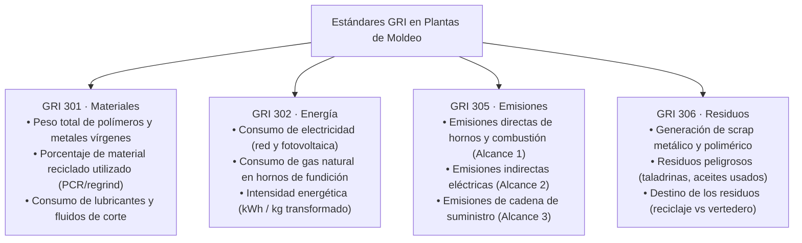
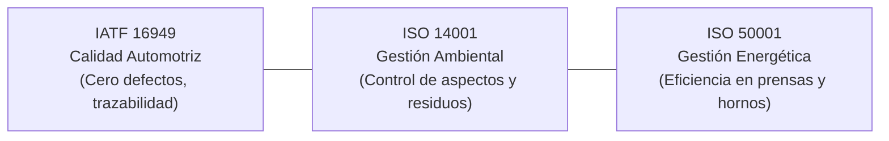
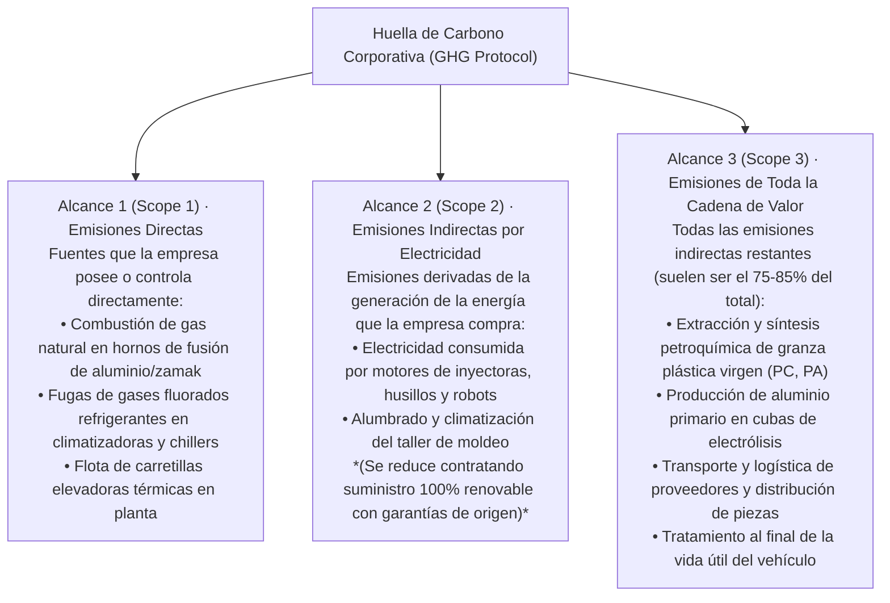

# Unidad 03 · Estándares, métricas e inversión responsable

RA1 · Criterios e, f
Métricas en Inyección
Métricas en Fundición
Alcances 1, 2 y 3 en Automoción

En una planta industrial no se puede mejorar lo que no se mide. Para un **Técnico Superior en Programación de la Producción**, la sostenibilidad se traduce en **números, ratios e indicadores verificables** calculados en el panel de control de la máquina de inyección o del horno de fundición: kilovatios-hora consumidos por kilo de granza fundida ($\text{kWh/kg}$), porcentaje de piezas defectuosas (*scrap rate*), gramos de lubricante por ciclo de inyección y kilogramos equivalentes de dióxido de carbono por pieza entregada al cliente.

En esta unidad analizamos los marcos formales de reporte no financiero, las normas de gestión ambiental y energética aplicables al sector, el cálculo de la huella de carbono bajo el estándar internacional **GHG Protocol** y el funcionamiento de la inversión socialmente responsable (ISR).

---

## 1. Marcos normativos de reporte y estándares internacionales

### 1.1 La Directiva Europea de Información sobre Sostenibilidad (CSRD) y los ESRS

La Directiva **CSRD (UE 2022/2464)** sustituye a la anterior directiva de información no financiera y obliga a miles de empresas medianas y grandes de la Unión Europea a publicar anualmente su **Estado de Información No Financiera (EINF)** auditado con el mismo rigor que las cuentas económicas tradicionales.

Los informes deben redactarse siguiendo las **Normas Europeas de Información sobre Sostenibilidad (ESRS - *European Sustainability Reporting Standards*)**, las cuales establecen módulos específicos de aplicación directa al sector de fabricación mecánica:
- **ESRS E1 (Cambio Climático):** Emisiones de gases de efecto invernadero (Alcance 1, 2 y 3), planes de transición hacia la neutralidad y consumo energético.
- **ESRS E2 (Contaminación):** Emisiones de contaminantes a la atmósfera (VOCs), agua y suelo procedentes de desmoldeantes, baños de desengrase y hornos.
- **ESRS E5 (Uso de Recursos y Economía Circular):** Entradas de materias primas vírgenes frente a recicladas, flujos de residuos (mazarotas, cascarillas) y ecodiseño de productos.

### 1.2 Estándares GRI (*Global Reporting Initiative*)

El estándar **GRI** es el marco de reporte voluntario más utilizado a nivel global para comunicar el impacto de las organizaciones. Los módulos GRI que afectan directamente al técnico de producción son:

---

## 2. Sistemas de Gestión Certificados en Planta

Una fábrica de componentes de automoción o matricería que pretenda operar en la cadena de valor de **Valeo** debe estar certificada en una tríada fundamental de normas:

1. **IATF 16949 (Gestión de Calidad en Automoción):** Exige el control estadístico de procesos (SPC), análisis modal de fallos y efectos (AMFE/FMEA) y eliminación del scrap. En automoción, una pieza con rebaba, alabeo o burbujas no solo es un fallo de calidad, sino un despilfarro ambiental inaceptable de energía y material.
2. **ISO 14001 (Sistemas de Gestión Ambiental):** Estructura el ciclo de mejora continua (PDCA - Planificar, Hacer, Verificar, Actuar) para prevenir la contaminación, gestionar los residuos peligrosos según la ley y cumplir con la **Autorización Ambiental Integrada (AAI)**.
3. **ISO 50001 (Sistemas de Gestión de la Energía):** Establece líneas base de consumo energético (*Energy Baselines - EnB*) y objetivos de reducción sistemática de kilovatios-hora en los equipos más intensivos (motores de bombas de inyección, resistencias calefactoras, enfriadoras de agua de moldes y compresores de aire neumático).

---

## 3. Contabilidad del Carbono: El Protocolo GHG (Alcances 1, 2 y 3)

El **GHG Protocol (*Greenhouse Gas Protocol*)** es el método internacional estándar para clasificar y contabilizar las emisiones de gases de efecto invernadero de una organización:

!!! example "El dilema de Valeo Martos con el Alcance 3"

    Una multinacional como **Valeo** puede descarbonizar casi por completo sus Alcances 1 y 2 en Martos instalando paneles solares en las cubiertas de las naves y electrificando sus carretillas y procesos de secado.
    
    Sin embargo, **el 85% de la huella de carbono de un proyector de automóvil reside en el Alcance 3**: es decir, en el carbono embebido (*embodied carbon*) dentro del policarbonato virgen con el que se inyecta la lente transparente y en el aluminio con el que se funde el disipador térmico de los LEDs. 
    
    Por esta razón, Valeo exige contractualmente a sus proveedores que suministren polímeros con contenido reciclado post-consumo (PCR) y aleaciones de aluminio secundario procedentes de chatarra reciclada.

---

## 4. Indicadores Clave de Desempeño (KPIs) en la Planta de Moldeo

El técnico responsable de programar la producción debe monitorear y optimizar de forma continua cuatro indicadores industriales críticos de sostenibilidad:

### 4.1 Consumo Específico de Energía ($\text{SEC}$)
Mide la cantidad de energía eléctrica consumida por cada kilogramo de materia prima procesada de forma conforme:
$$\text{SEC} = \frac{E_{\text{total}} \text{ (kWh)}}{M_{\text{conforme}} \text{ (kg)}}$$
- **Inyección de termoplásticos:** Un valor típico de referencia oscila entre **0,9 y 1,5 kWh/kg** en inyectoras hidráulicas antiguas, y puede reducirse hasta **0,35 - 0,55 kWh/kg** en inyectoras 100% eléctricas de última generación.
- **Fundición inyectada de aluminio:** Incluyendo la fusión en horno y la máquina de inyección a presión (HPDC), oscila entre **2,5 y 4,0 kWh/kg**.

### 4.2 Tasa de Desecho (*Scrap Rate*)
Porcentaje de material que resulta defectuoso respecto a la producción total inyectada:
$$\text{Tasa de Scrap (\%)} = \frac{M_{\text{piezas defectuosas}} + M_{\text{purgas no recuperadas}}}{M_{\text{materia prima alimentada}}} \times 100$$
En la industria del automóvil, el objetivo de planta se fija por debajo del **1,0% - 1,5%**, implementando sistemas de visión artificial y control adaptativo de presiones de mantenimiento en el molde.

### 4.3 Tasa de Reincorporación de Triturado (*Regrind Ratio*)
Porcentaje de granza triturada procedente de mazarotas y canales fríos que se reincorpora a la tolva junto con la granza virgen:
$$\text{Tasa de Regrind (\%)} = \frac{M_{\text{triturado}}}{M_{\text{triturado}} + M_{\text{virgen}}} \times 100$$
En piezas técnicas estructurales o no visibles (carcasas traseras de faros en polipropileno o PBT), este porcentaje puede alcanzar entre un **15% y un 30%** sin merma mecánica. En componentes ópticos transparentes de máxima pureza (lentes exteriores de policarbonato o PMMA), el cliente automotriz suele prohibir el uso de triturado por riesgo de amarilleamiento o inclusiones ópticas.

### 4.4 Intensidad de Carbono por Componente
Huella de carbono individual calculada por cada referencia de pieza producida:
$$\text{Huella} = \text{Masa (kg)} \times \text{Factor Emisión Material} + \text{Consumo (kWh)} \times \text{Factor Mix Eléctrico}$$

---

## 5. Inversión Socialmente Responsable (ISR) y Agencias de Rating

Las decisiones de financiación y compra de maquinaria en el polígono industrial de Martos están condicionadas por los mercados de capitales sostenibles:

- **Inversión Socialmente Responsable (ISR):** Práctica inversora que integra factores ASG en las decisiones financieras junto con la rentabilidad económica. Fondos europeos como los **NextGenerationEU** y préstamos bancarios bonificados condicionan sus tipos de interés a que la planta reduzca sus consumos energéticos auditados.
- **Agencias de Rating y Calificación ASG (EcoVadis, CDP, MSCI):** Plataformas como **EcoVadis** son el estándar de evaluación en la cadena de suministro de automoción. Una planta de matricería o inyección recibe una puntuación (Medalla de Bronce, Plata, Oro o Platino) en función de sus políticas ambientales, derechos laborales y compras sostenibles. Obtener una mala calificación en EcoVadis inhabilita a la empresa para recibir contratos de los grandes fabricantes.
