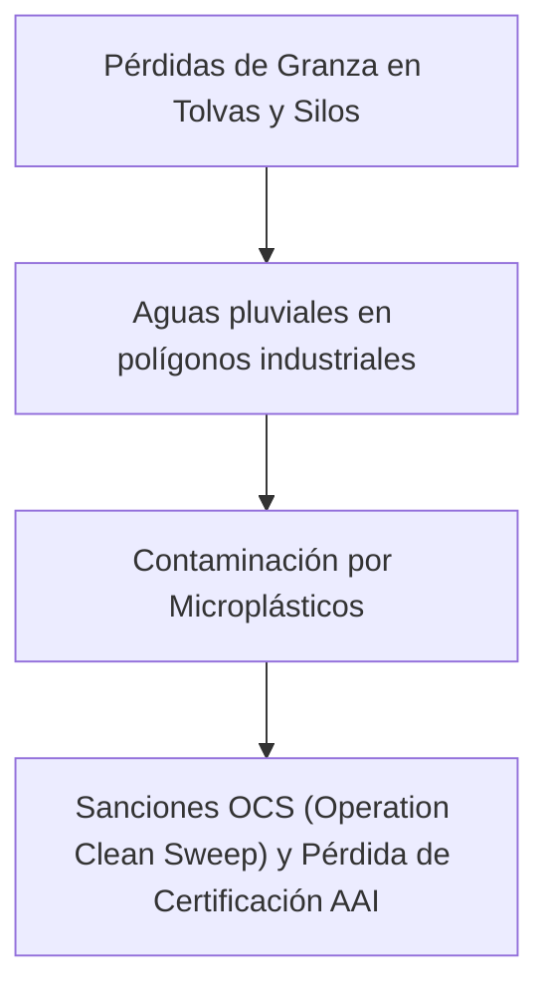
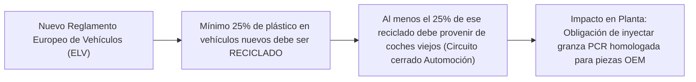
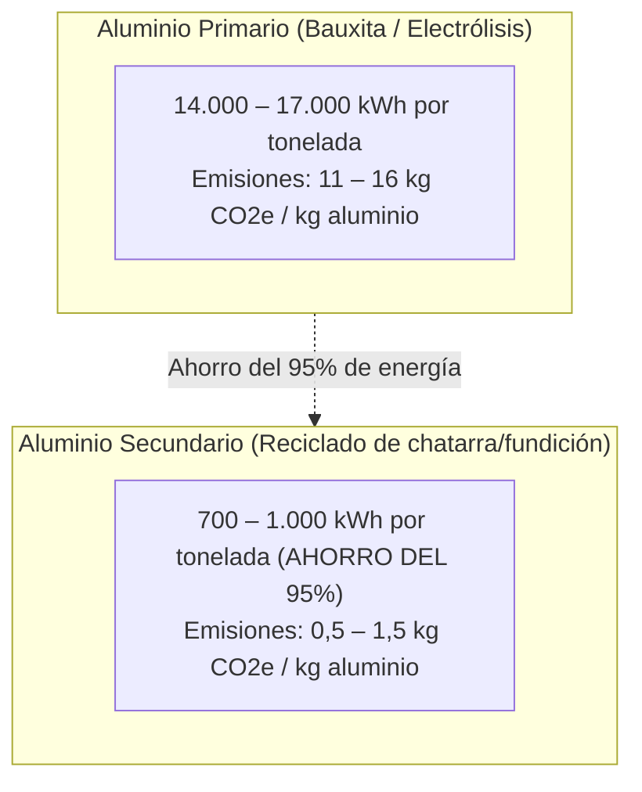
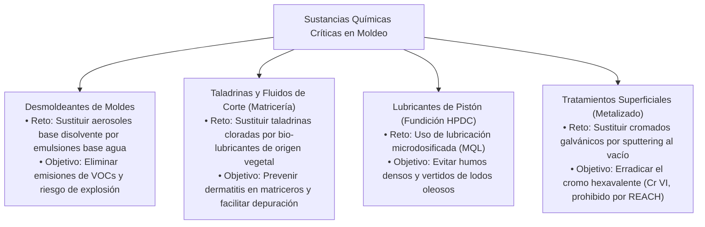
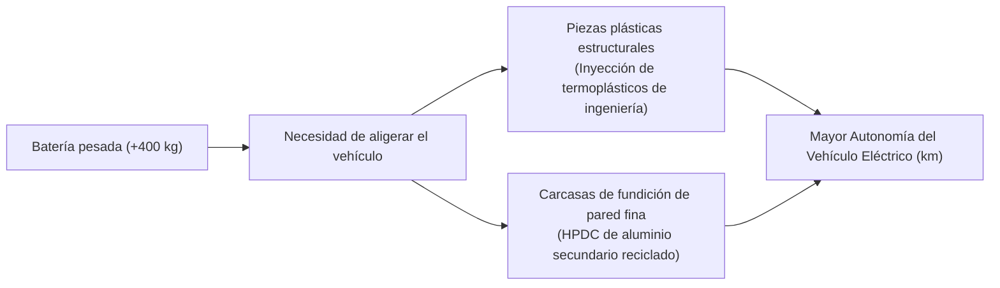

# Unidad 04 · Retos ambientales y sociales en el moldeo de metales y polímeros

RA2 · Criterios a–e
Crisis del Plástico y PCR
Hornos y Fusión de Metales
Regulación Automotriz ELV

La industria de la transformación de materiales plásticos y la fundición metálica se encuentra en el epicentro de la mayor encrucijada regulatoria y tecnológica de su historia. Por un lado, la sociedad y la Unión Europea exigen erradicar la contaminación por plásticos, reducir drásticamente el consumo de combustibles fósiles y eliminar sustancias químicas peligrosas. Por otro lado, la transición hacia el **vehículo eléctrico**, la generación de energías renovables y la digitalización exigen volúmenes crecientes de piezas plásticas técnicas de bajo peso (*lightweighting*) y componentes metálicos de fundición inyectada con alta conductividad térmica para disipar el calor de baterías y sistemas electrónicos LED.

En esta unidad analizamos los cuatro grandes retos ambientales y los retos sociales que marcan el día a día de las plantas productivas en Martos y Andalucía.

---

## 1. El reto de los polímeros: Regulación y cuotas de reciclado

### 1.1 La problemática de los microplásticos y el estigma social
Aunque la inyección de termoplásticos de ingeniería (como policarbonatos, poliamidas o polipropilenos reforzados) produce componentes de **larga vida útil** (un faro de coche o una pieza estructural dura más de 15 años en servicio), el sector arrastra el estigma de la contaminación marina generada por los envases de un solo uso. 

Además, las pérdidas involuntarias de **granza (*pellets*)** durante la descarga de camiones cisterna, roturas de sacos en tolvas o limpiezas de silos acaban en los colectores de aguas pluviales, convirtiéndose en microplásticos primarios que contaminan los cauces fluviales. La Unión Europea tramita ya una estricta directiva para sancionar cualquier fuga de granza industrial (*Operation Clean Sweep - OCS*).

### 1.2 La Directiva de Vehículos al Final de su Vida Útil (ELV) y las cuotas de PCR
El cambio regulatorio más disruptivo para el clúster de Martos es la revisión del **Reglamento sobre Diseño Circular de Vehículos (Propuesta ELV de la Comisión Europea)**:

Esta exigencia plantea enormes retos técnicos para el programador de producción:
- **Variabilidad reológica:** La granza reciclada post-consumo (PCR) presenta fluctuaciones en el índice de fluidez (*Melt Flow Index - MFI*) de un lote a otro, lo que exige ajustar continuamente la presión de inyección y los perfiles de velocidad para evitar rebabas o llenados incompletos.
- **Degradación térmica y olor:** Los polímeros reciclados han sufrido múltiples ciclos de calor; requieren ventanas térmicas de procesado más estrechas y deshumidificación exhaustiva para evitar burbujas y degradación de cadenas.
- **Propiedades ópticas:** En componentes transparentes (lentes de faros en policarbonato o PMMA), el uso de PCR todavía está limitado por la presencia de impurezas microscópicas que distorsionan el haz de luz legal exigido en la homologación del vehículo.

---

## 2. El reto de la fundición metálica: Descarbonización de hornos

### 2.1 La gigantesca brecha energética: Aluminio primario vs secundario
El aluminio es el metal ligero por excelencia en automoción (densidad de $2,7 \text{ g/cm}^3$ frente a $7,8 \text{ g/cm}^3$ del acero). Sin embargo, su obtención primaria mediante la electrólisis de bauxita (proceso Hall-Héroult) es uno de los procesos industriales más contaminantes del planeta:

El reto ambiental inmediato de las fundiciones inyectadas de Martos y Andalucía es **garantizar el suministro de lingotes de aluminio 100% secundario** certificado para la fabricación de carcasas de disipación térmica de luminarias y soportes mecánicos, reduciendo la huella de carbono de la pieza en más de un 85%.

### 2.2 Eficiencia en hornos de fusión y escorias (*Dross*)
- **Emisiones directas de hornos:** La fusión de metales en crisoles de gas natural libera gases de combustión ($\text{CO}_2, \text{NO}_x$). La modernización pasa por sustituirlos por hornos de inducción eléctricos o quemadores recuperativos/regenerativos que precalientan el aire de combustión con los propios humos de escape.
- **Gestión de escorias y cascarillas:** En la superficie del aluminio fundido se genera una capa de óxido metálico (*escoria o dross*) que arrastra hasta un 40-60% de metal útil. La implantación de procesos de recuperación mecánica de escorias en caliente permite reincorporar el metal líquido inmediatamente al crisol sin perderlo en vertedero.

---

## 3. Retos químicos: Fluidos de corte, desmoldeantes y barnices

El proceso de moldeo y fabricación de utillajes matriceros requiere sustancias químicas que conllevan graves riesgos ambientales y de salud si no se controlan:

---

## 4. La transición al Vehículo Eléctrico y el Aligeramiento (*Lightweighting*)

La electrificación del automóvil representa tanto un desafío existencial como una gigantesca oportunidad para el técnico de moldeo:

- **El desafío del peso de la batería:** Un coche eléctrico pesa entre **300 y 500 kg más** que su equivalente de combustión debido al paquete de baterías de ion-litio. Para compensar este sobrepeso y maximizar la autonomía del vehículo, los fabricantes demandan un aligeramiento extremo (*lightweighting*) de todos los componentes restantes.
- **La respuesta del moldeo:**
  1. Sustitución de piezas de chapa estampada de acero por componentes de **termoplásticos de ingeniería reforzados con fibra de vidrio (PA66-GF30, PBT-GF20)** o compuestos aligerados.
  2. Sustitución de cajas y disipadores pesados por piezas de **fundición inyectada a alta presión (HPDC) de aluminio o magnesio de pared delgada** (espesores de 1,5 a 2 mm con nervaduras estructurales optimizadas).

---

## 5. Retos Sociales y de Salud Laboral en la Planta de Moldeo

La dimensión social de la sostenibilidad en las plantas de moldeo se centra en tres pilares irrenunciables:

### 5.1 Prevención de riesgos laborales graves
- **Atrapamientos en prensas:** Bloqueos automáticos de seguridad hidráulica y eléctrica en puertas de prensas de inyección para evitar que operarios o ajustadores puedan acceder al área de molde con la bomba presurizada.
- **Quemaduras térmicas y salpicaduras:** Uso de trajes aluminizados, caretas faciales y robots automáticos de colada en fundición a presión, eliminando la manipulación manual de cazos con metal a 700 °C.
- **Higiene industrial de humos:** Instalación de campanas de aspiración localizada en la boquilla de inyección y sobre los crisoles para evacuar humos de pirólisis de polímeros y nieblas de desmoldeante.

### 5.2 Empleo industrial cualificado y reto demográfico
El mantenimiento de factorías industriales tecnificadas en Martos es la clave para fijar población en la provincia de Jaén, generando puestos de trabajo técnicos de alto valor añadido para los graduados de Formación Profesional, con salarios superiores a la media regional y planes de carrera profesional sólidos.
