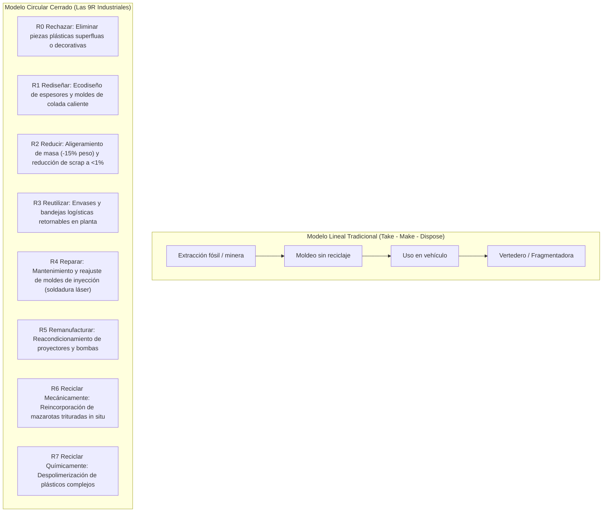
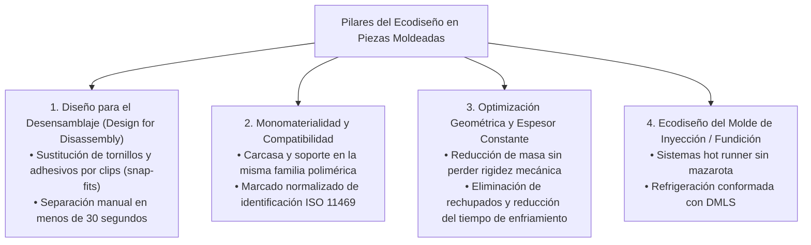
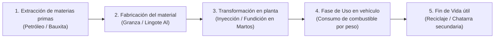

# Unidad 05 · Economía circular, procesos verdes y ecodiseño

RA4 · Criterios a–f
Ecodiseño en Inyección
Aligeramiento en Fundición
Análisis de Ciclo de Vida (LCA)

Hasta el 80% del impacto ambiental de un producto industrial se determina durante su **fase de diseño y concepción técnica**. Una vez que un molde de acero de 15 toneladas para una carcasa o lente de proyector ha sido mecanizado y templado, corregir un defecto que genera rechupados, rebabas o que exige un canal frío con una mazarota de 100 gramos resulta extremadamente costoso o físicamente imposible.

El **ecodiseño** consiste en integrar sistemáticamente los criterios ambientales en el diseño de la pieza y del molde, garantizando que el componente consuma la mínima cantidad de energía y materia prima durante su fabricación, preste su servicio con máxima durabilidad y sea fácil de desensamblar y reciclar al final de su vida útil.

---

## 1. De la economía lineal a la circular: Las 9R en moldeo

### Aplicación práctica de las 9R en el taller de Martos:
R1 Rediseñar (Ecodiseño)
: Sustituir canales de colada fría que generan residuos de mazarota en cada inyectada por **sistemas de colada caliente (*hot runners*) con boquillas valvuladas**, inyectando el material directamente en la cavidad de la pieza sin generar ni un solo gramo de desperdicio.

R4 Reparar (Mantenimiento de utillajes)
: Empleo de técnicas de micro-soldadura láser y recubrimientos PVD de baja fricción en noyós y postizos desgastados del molde, alargando su vida productiva de 500.000 a más de 1.500.000 ciclos antes de requerir un molde nuevo.

R6 Reciclar (Circuito cerrado de taller)
: Molinos granuladores situados junto a cada prensa de inyección (*granuladores a pie de máquina*) que trituran las coladas calientes inmediatamente y las reincorporan mediante un alimentador proporcional a la tolva principal.

---

## 2. Metodología de Ecodiseño en Piezas Plásticas y Metálicas

El nuevo Reglamento europeo sobre **Ecodiseño para Productos Sostenibles (ESPR - *Ecodesign for Sustainable Products Regulation*)** impone requisitos obligatorios de durabilidad, reparabilidad y reciclabilidad en los componentes industriales.

### 2.1 Diseño para el Desensamblaje (*Design for Disassembly - DfD*)
En una planta de desguace o centro CAT (Centro Autorizado de Tratamiento de Vehículos), un operario o un robot de desmontaje solo dispone de **30 a 60 segundos** para desarmar un faro completo. Si las distintas piezas están pegadas con adhesivos de poliuretano irreversibles o unidas mediante insertos metálicos sobremoldeados (*brass inserts*), el componente se desecha en la fragmentadora mixta, perdiéndose el valor del plástico:

- **Uniones clipadas (*Snap-fits*):** Diseñar pestañas elásticas moldeadas en la propia pieza plástica que encajen a presión y puedan liberarse con un destornillador plano o presión manual.
- **Evitar insertos metálicos sobremoldeados no ferromagnéticos:** Si se sobremoldean casquillos de latón en piezas de poliamida, los imanes de las plantas de reciclaje no pueden separarlos y las cuchillas de los molinos de triturado se destruyen. La solución de ecodiseño pasa por diseñar roscas directas autorroscantes para plástico o utilizar casquillos ferromagnéticos separables.

### 2.2 Monomaterialidad y compatibilidad polimérica
Uno de los mayores errores de diseño es mezclar materiales incompatibles que no pueden fundirse juntos en el reciclaje mecánico:

| Componente | Diseño tradicional lineal (Incompatible) | Rediseño Ecodiseñado (Compatible / Monomaterial) | Beneficio de Reciclaje |
|---|---|---|---|
| **Lente exterior de faro** | Policarbonato (PC) | Policarbonato (PC) óptico virgen | Mantiene transparencia obligatoria. |
| **Bisel decorativo interior** | Policarbonato/ABS metalizado | Policarbonato (PC) con acabado superficial de molde | Compatible al 100% con la lente en reciclaje. |
| **Carcasa trasera estructural** | Polipropileno con talco (PP-TD20) | Policarbonato reciclado (rPC) o PP compatible | Toda la pieza puede triturarse en un único flujo de material. |

### 2.3 Marcado obligatorio de materiales (Norma ISO 11469 / ISO 1043)
Toda pieza inyectada que pese más de 50 gramos debe llevar grabado en su molde el código normalizado de identificación de material:
$$\text{Ejemplo: } >\text{PC-HT}<\quad\text{o}\quad >\text{PP-TD20}<\quad\text{o}\quad >\text{AlSi9Cu3(Fe)}<$$
Esto permite a las líneas de clasificación óptica por infrarrojo cercano (NIR) de los gestores de residuos segregar la pieza automáticamente en su tolva correcta.

---

## 3. Análisis de Ciclo de Vida (LCA / ACV según ISO 14040/14044)

El **Análisis de Ciclo de Vida (LCA - *Life Cycle Assessment*)** es la metodología científica normalizada por la ISO para cuantificar de forma objetiva los impactos ambientales de un producto a lo largo de todas las etapas de su existencia.

### 3.1 Las 4 fases normalizadas de un estudio de ACV (ISO 14040)
1. **Definición del objetivo y alcance:** Se fija la **Unidad Funcional (UF)**. Por ejemplo: *«Proporcionar iluminación frontal conforme a normativa ECE para 150.000 km de vida útil de un vehículo de turismo»*.
2. **Análisis de Inventario de Ciclo de Vida (LCI):** Cuantificación de todas las entradas (kg de plástico, litros de agua de refrigeración, kWh de inyección, gramos de lubricante) y salidas (emisiones de $\text{CO}_2$, $\text{SO}_2$, kg de scrap, vertidos).
3. **Evaluación del Impacto del Ciclo de Vida (LCIA):** Conversión de las emisiones del inventario en categorías de daño ambiental:
   - *Calentamiento global / Huella de carbono* ($\text{kg CO}_2\text{ equivalente}$).
   - *Agotamiento de recursos fósiles* ($\text{MJ de energía fósil}$).
   - *Acidificación del suelo y agua* ($\text{kg SO}_2\text{ equivalente}$).
   - *Eutrofización* ($\text{kg PO}_4^{3-}\text{ equivalente}$).
4. **Interpretación de resultados:** Identificación de los puntos críticos (*hotspots*) donde aplicar medidas de ecodiseño.

### 3.2 Ejemplo comparativo de ACV: Disipador de calor LED

| Alternativa de diseño | Material utilizado | Masa de la pieza | Emisiones en Fabricación | Impacto en Uso (150.000 km) | Huella de Carbono Total |
|---|---|:---:|:---:|:---:|:---:|
| **Opción A (Tradicional)** | Aluminio primario de fundición (HPDC) | 450 g | $6,30\text{ kg CO}_2\text{e}$ | $1,20\text{ kg CO}_2\text{e}$ | **$7,50\text{ kg CO}_2\text{e}$** |
| **Opción B (Ecodiseñada Metálica)** | Aluminio secundario 100% reciclado | 380 g (optimizado) | $0,45\text{ kg CO}_2\text{e}$ | $1,01\text{ kg CO}_2\text{e}$ | **$1,46\text{ kg CO}_2\text{e}$ (–80%)** |
| **Opción C (Ecodiseñada Polimérica)** | Poliamida térmica conductora (PA66-TC) | 260 g | $1,56\text{ kg CO}_2\text{e}$ | $0,69\text{ kg CO}_2\text{e}$ | **$2,25\text{ kg CO}_2\text{e}$ (–70%)** |

!!! tip "Conclusión del estudio de ACV"

    El Análisis de Ciclo de Vida demuestra que sustituir aluminio primario por aluminio reciclado secundario reduce el impacto de calentamiento global en un **80%**, siendo incluso más sostenible que la alternativa plástica debido a la reducidísima energía requerida para refundir chatarra de aluminio.
