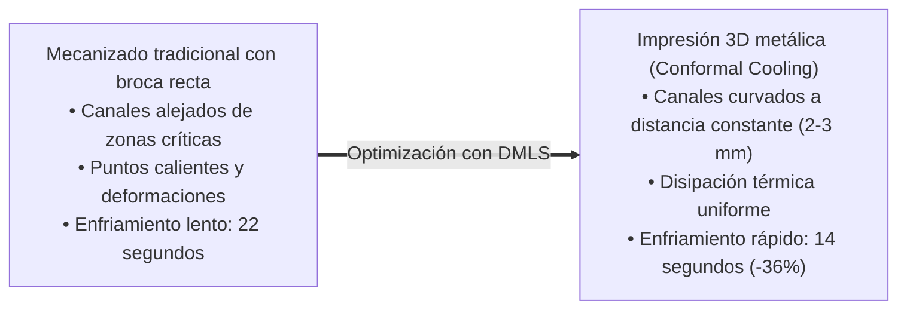
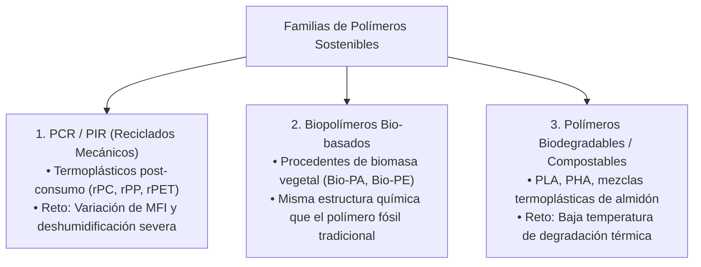

# Unidad 06 · Actividades y tecnologías sostenibles en moldeo y matricería

RA5 · Criterios a–i
Inyectoras 100% Eléctricas
Conformal Cooling y DMLS
Mejores Técnicas Disponibles (MTD/BAT)

La sostenibilidad en una fábrica de moldeo no se logra únicamente eligiendo buenos materiales; se ejecuta cada segundo en la planta a través de las **tecnologías de transformación seleccionadas y los parámetros de proceso programados**.

Un Técnico Superior en Programación de la Producción influye directamente sobre el consumo energético de la factoría, la vida útil de los moldes de acero y el volumen de emisiones contaminantes. En esta unidad analizamos la revolución de las inyectoras eléctricas, la refrigeración conformada de moldes, el comportamiento de los biopolímeros y el marco legal ambiental de la **Autorización Ambiental Integrada (AAI)** en Andalucía.

---

## 1. La batalla tecnológica: Inyectoras hidráulicas vs. 100% eléctricas

El equipo más consumidor de energía en una planta de plástico es la **máquina de inyección**. Durante décadas, las prensas hidráulicas dominaron el mercado. Hoy, la transición hacia máquinas servohidráulicas y **100% eléctricas (*All-Electric*)** es el pilar de descarbonización de plantas como las de Martos:

```mermaid
flowchart TD
    subgraph HIDRAULICA ["Prensa Hidráulica Convencional"]
        H1["Motor eléctrico acciona bomba hidráulica continua"] --> H2["Aceite a presión circula por válvulas proporcionales"]
        H2 --> H3["Generación continua de calor por fricción en aceite"]
        H3 --> H4["Chiller debe enfriar el aceite (doble gasto energético)"]
        H4 --> H5["Riesgo de fugas de fluido hidráulico (500-1.500 litros)"]
    end

    subgraph ELECTRICA ["Prensa 100% Eléctrica (Servomotores Independientes)"]
        E1["Servomotores dedicados por eje: Inyección, Cierre, Plastificación, Expulsión"]
        E1 --> E2["Consumo eléctrico ÚNICAMENTE durante el movimiento activo"]
        E2 --> E3["Cero consumo en tiempos de enfriamiento y parada"]
        E3 --> E4["Recuperación de energía cinética en frenado (KERS)"]
        E4 --> E5["Ausencia total de aceite hidráulico en el taller"]
    end
```

### 1.1 Comparativa técnica y económica de operación

| Parámetro operativo | Inyectora Hidráulica Tradicional | Inyectora Servohidráulica Moderna | Inyectora 100% Eléctrica (*All-Electric*) |
|---|:---:|:---:|:---:|
| **Consumo específico ($\text{kWh/kg}$)** | $1,10 - 1,60\text{ kWh/kg}$ | $0,65 - 0,90\text{ kWh/kg}$ | **$0,35 - 0,50\text{ kWh/kg}$ (–65%)** |
| **Consumo en reposo / enfriamiento** | Continuo (bomba recirculando) | Muy bajo (motor parado) | **Cero vatios** |
| **Aceite hidráulico en máquina** | 400 – 2.000 litros | 200 – 600 litros | **0 litros (Limpio)** |
| **Nivel de ruido en planta** | 75 – 82 dB(A) | 68 – 74 dB(A) | **< 62 dB(A) (Silenciosa)** |
| **Repetibilidad y precisión** | ±0,5% carrera de inyección | ±0,2% carrera | **±0,01% carrera (Cero scrap)** |
| **Tiempo de ciclo** | Movimientos secuenciales | Solapamiento parcial | **Movimientos simultáneos independientes** |

!!! tip "Cálculo de ahorro energético en el examen"

    Una inyectora de 300 toneladas que transforma $120\text{ kg/h}$ de policarbonato durante 6.000 horas anuales:
    - Prensa hidráulica ($1,2\text{ kWh/kg}$): $120 \times 6.000 \times 1,2 = 864.000\text{ kWh/año}$
    - Prensa eléctrica ($0,45\text{ kWh/kg}$): $120 \times 6.000 \times 0,45 = 324.000\text{ kWh/año}$
    - **Ahorro neto anual:** $540.000\text{ kWh/año}$. Al precio industrial medio de $0,14\text{ €/kWh}$, supone un ahorro de **75.600 € al año** y una reducción directa de **135 toneladas de $\text{CO}_2$** al año por cada máquina.

---

## 2. Ecoeficiencia en el Molde: Refrigeración Conformada (*Conformal Cooling*)

El tiempo de enfriamiento de la pieza dentro del molde representa habitualmente entre el **60% y el 75% del tiempo total de ciclo**. Reducir el tiempo de enfriamiento ahorra millones de kilovatios-hora en la planta y aumenta la productividad sin comprar más máquinas.

### 2.1 El límite del mecanizado clásico y la revolución DMLS
En moldes tradicionales, los canales de agua se taladran con brocas rectas en bloques de acero templado. Esto genera canales rectilíneos que pasan lejos de las zonas con geometrías curvas complejas, provocando enfriamientos desiguales, tensiones residuales, alabeos y tiempos de espera prolongados.

La **refrigeración conformada (*Conformal Cooling*)** utiliza fabricación aditiva metálica mediante fusión selectiva por láser (**DMLS / SLM**): imprime los postizos de acero del molde con canales internos curvados que siguen con exactitud la silueta de la cavidad plástica o metálica:

---

## 3. Procesado de Polímeros Sostenibles y Bioplásticos

El técnico de producción debe adaptar los parámetros estándar de inyección cuando trabaja con polímeros sostenibles:

### 3.1 Claves de programación de proceso para polímeros reciclados (PCR)
1. **Control de humedad previo:** Los plásticos técnicos reciclados son especialmente susceptibles a la hidrólisis si no se deshumidifican adecuadamente en tolvas de aire seco con punto de rocío (*dew point*) de –40 °C.
2. **Filtración de masa fundida:** Uso de boquillas con filtros de malla metálica integrados para retener microimpurezas de pintura o polvo que podrían taponar las compuertas de inyección.
3. **Control por presión de cavidad:** Instalación de sensores piezoeléctricos de presión directamente dentro del molde. El sistema ajusta automáticamente la conmutación a presión de mantenimiento (*V/P changeover*) en cada inyectada, compensando las variaciones de fluidez de la granza reciclada.

---

## 4. Tecnologías Limpias en Fundición Inyectada (HPDC)

En la fundición a alta presión de aleaciones de aluminio y zamak, las actividades de ecoeficiencia se centran en:
- **Hornos dosificadores cerrados de alta eficiencia:** Sustituyen a los antiguos crisoles abiertos. Mantienen el aluminio líquido a $690\text{ }^\circ\text{C}$ con un aislamiento térmico avanzado, reduciendo el consumo energético en un 40% y minimizando la formación de escorias superficiales (*dross*).
- **Lubricación de mínima cantidad (MQL) en el molde:** En lugar de regar el molde con miles de litros de emulsión acuosa que genera efluentes sucios y choque térmico en el acero, se pulverizan microgotas de lubricante concentrado mediante cabezales robotizados de alta precisión.
- **Inyección semisólida (*Thixomolding / Rheocasting*):** Inyección del metal en estado pastoso (semisólido). Opera a menores temperaturas, prolonga la vida útil del molde en un 300% y produce piezas sin porosidades aptas para tratamiento térmico.

---

## 5. Marco Normativo Ambiental en Andalucía

Cualquier planta industrial de inyección o fundición en Martos debe cumplir estrictamente la normativa ambiental comunitaria y andaluza:

### 5.1 Autorización Ambiental Integrada (AAI)
Regulada por la **Directiva IED (Directiva 2010/75/UE)** y la **Ley 7/2007 (GICA de Andalucía)**. Exige a las fábricas de transformación aplicar obligatoriamente las **Mejores Técnicas Disponibles (MTD / BAT - *Best Available Techniques*)**:
- Valores Límite de Emisión (VLE) para partículas y compuestos orgánicos volátiles (VOCs) en chimeneas de extracción.
- Planes de minimización de ruido perimetral nocturno en zonas limítrofes a cascos urbanos.
- Registro Estatal de Emisiones y Fuentes Contaminantes (**PRTR-España**).

### 5.2 Ley 7/2022 de Residuos y Suelos Contaminados
- **Jerarquía estricta de residuos:** 1. Prevención $\rightarrow$ 2. Preparación para la reutilización $\rightarrow$ 3. Reciclaje $\rightarrow$ 4. Valorización energética $\rightarrow$ 5. Vertedero (prohibido para residuos valorizables).
- Obligatoriedad de disponer de un **Plan de Minimización de Residuos Peligrosos** aprobado para aceites hidráulicos usados, taladrinas y trapos contaminados.
- **Impuesto sobre envases de plástico no reutilizables (0,45 €/kg):** Aplica a cualquier embalaje o bandeja plástica no reciclada que salga de la fábrica.
