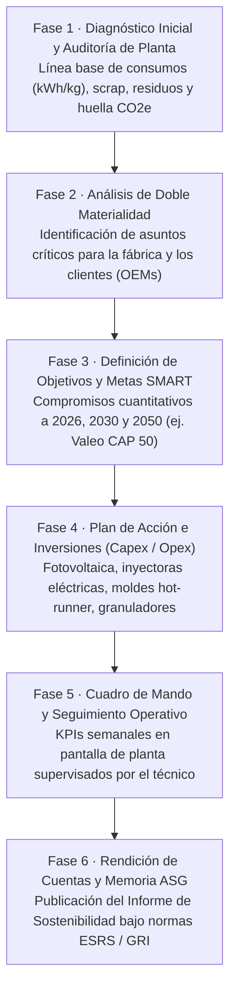
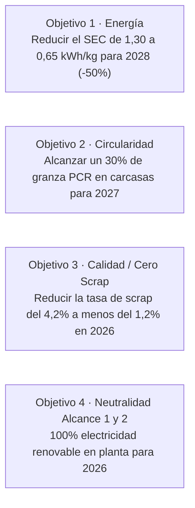

# Unidad 07 · Plan de sostenibilidad e informe de desempeño ASG

<span class="badge badge-ra">RA6 · Criterios a–e</span>
<span class="badge badge-polimero">Plan de Descarbonización</span>
<span class="badge badge-metal">Auditoría de Planta</span>
<span class="badge badge-valeo">Memoria ASG / CSRD</span>

Un **Plan de Sostenibilidad Industrial** no es una declaración de intenciones ni un folleto corporativo; es un **documento estratégico y operativo vinculante** que compromete los recursos técnicos, económicos y humanos de la empresa para reducir sus impactos ambientales negativos, mitigar riesgos regulatorios y capitalizar oportunidades comerciales de mercado.

Para una empresa del sector del moldeo en Martos, contar con un plan de sostenibilidad riguroso y un **Informe de Desempeño ASG auditado** es el requisito indispensable para mantener su homologación como proveedor de primer nivel (*Tier 1*) en la industria del automóvil y acceder a líneas de crédito bancario bonificadas.

---

## 1. Estructura y Fases de Elaboración del Plan

El diseño de un plan de sostenibilidad eficaz en una planta de moldeo sigue una metodología de seis fases secuenciales:



---

## 2. Fase 1: Diagnóstico de Partida y Línea Base de Planta

Antes de proponer mejoras, es imprescindible realizar una **auditoría integral de flujos de masa y energía** en el taller de moldeo. La línea base representa el punto de partida numérico frente al cual se medirá cualquier progreso:

### Ejemplo de línea base de una factoría de inyección en Martos (Año Base 2024):
- **Parque de maquinaria:** 24 máquinas de inyección (18 hidráulicas de media de 12 años de antigüedad, 6 servohidráulicas).
- **Materia prima procesada:** $2.400\text{ toneladas/año}$ (92% policarbonato y polipropileno virgen, 8% triturado interno).
- **Consumo eléctrico anual:** $3.120.000\text{ kWh/año}$ (Mix de red eléctrica convencional).
- **Consumo específico medio ($\text{SEC}$):** $1,30\text{ kWh/kg}$.
- **Tasa media de scrap:** $4,2\%$ (100,8 toneladas de piezas no conformes y purgas desechadas).
- **Huella de carbono corporativa:**
  - Alcance 1: $140\text{ t CO}_2\text{e}$ (fugas de gas fluorado R-410A en enfriadoras y carretillas diésel).
  - Alcance 2: $780\text{ t CO}_2\text{e}$ (electricidad de red convencional).
  - Alcance 3: $14.800\text{ t CO}_2\text{e}$ (emisiones embebidas en el policarbonato virgen adquirido).

---

## 3. Fase 2 y 3: Objetivos SMART y Metas de Descarbonización

Los objetivos del plan deben formularse bajo el estándar **SMART** (*Específicos, Medibles, Alcanzables, Relevantes y con Plazo temporal definido*):



---

## 4. Fase 4: Plan de Acción y Presupuesto de Inversión (Capex / Opex)

El plan debe traducir los objetivos técnicos en un cronograma de proyectos con dotación económica y cálculo de retorno de inversión (*Payback*):

| Proyecto Técnico | Tipo de Gasto | Inversión Estimada | Ahorro Anual (€/año) | Reducción de Emisiones | Retorno (*Payback*) |
|---|:---:|:---:|:---:|:---:|:---:|
| **1. Planta Solar Fotovoltaica en Cubierta (800 kWp)** | Capex | 560.000 € | 145.000 €/año | $-320\text{ t CO}_2\text{e/año}$ | **3,8 años** |
| **2. Sustitución de 4 inyectoras hidráulicas por 100% eléctricas** | Capex | 720.000 € | 110.000 €/año | $-220\text{ t CO}_2\text{e/año}$ | **6,5 años** |
| **3. Granuladores a pie de máquina para triturado in situ** | Capex | 48.000 € | 62.000 €/año | $-45\text{ t CO}_2\text{e/año}$ | **0,8 años** |
| **4. Aislamiento térmico de camisas de husillo con mantas cerámicas** | Opex | 12.000 € | 28.000 €/año | $-55\text{ t CO}_2\text{e/año}$ | **0,4 años** |
| **5. Sustitución de desmoldeantes en spray por emulsión base agua** | Opex | 4.500 € | 8.000 €/año | $-12\text{ t VOCs/año}$ | **0,6 años** |

---

## 5. Fase 5: Cuadro de Mando de KPIs (*Dashboard* en Planta)

Para que el plan viva en el taller diario, los indicadores clave deben ser visibles en tiempo real para el equipo de producción mediante pantallas instaladas en la nave:

```text title="cuadro-mando-taller.txt"
╔══════════════════════════════════════════════════════════════════════════════╗
║               CUADRO DE MANDO DE SOSTENIBILIDAD · PLANTA MARTOS              ║
╠══════════════════════════════════════════════════════════════════════════════╣
║ Métrica en Tiempo Real          │ Objetivo 2026  │ Valor Actual │ Estado     ║
╟─────────────────────────────────┼────────────────┼──────────────┼────────────╢
║ Consumo Específico (SEC)        │ ≤ 0,70 kWh/kg  │  0,64 kWh/kg │ [✅ BIEN]  ║
║ Tasa de Scrap Diario            │ ≤ 1,20 %       │  1,08 %      │ [✅ BIEN]  ║
║ Porcentaje de Reciclado (PCR)   │ ≥ 25,0 %       │  22,4 %      │ [⚠️ ATENC] ║
║ Fugas de Aire Comprimido (m3/h) │ ≤ 15 m3/h      │  28 m3/h     │ [❌ ALERTA]║
║ Días sin accidentes laborales   │ 365 días       │  214 días    │ [✅ BIEN]  ║
╚══════════════════════════════════════════════════════════════════════════════╝
```

---

## 6. Fase 6: Elaboración de la Memoria ASG / Informe de Sostenibilidad

El informe final se estructura según las directrices del **Estado de Información No Financiera (EINF)** y las normas europeas **ESRS**:

### Estructura formal del documento:
1. **Carta de la Dirección General:** Compromiso de la alta dirección con la descarbonización industrial de Martos y la inversión responsable.
2. **Modelo de negocio y cadena de valor:** Descripción de las líneas de inyección y fundición, clientes automotrices y principales mercados.
3. **Gobernanza de la sostenibilidad:** Comité de sostenibilidad, certificaciones IATF 16949, ISO 14001 e ISO 50001.
4. **Matriz de doble materialidad:** Resultados del diálogo con clientes (Valeo/OEMs), trabajadores, proveedores y administración ambiental.
5. **Capítulo Ambiental (ESRS E1, E2, E5):**
   - Huella de carbono desglosada por Alcance 1, 2 y 3.
   - Consumo de electricidad, gas y combustibles.
   - Balances de materias primas vírgenes, secundarias y recicladas.
   - Gestión de residuos peligrosos (taladrinas, aceites) y no peligrosos (scrap).
6. **Capítulo Social (ESRS S1):**
   - Estadísticas de siniestralidad laboral (Índice de Frecuencia y Gravedad).
   - Formación técnica del personal y programa de FP Dual.
   - Medidas de igualdad y conciliación laboral.
7. **Capítulo de Gobernanza (ESRS G1):**
   - Políticas anticorrupción y código de conducta ético.
   - Trazabilidad de proveedores y debida diligencia en materias primas.
8. **Anexo de tablas de indicadores (Índice de contenidos GRI / ESRS).**
