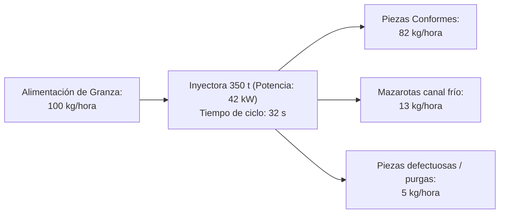
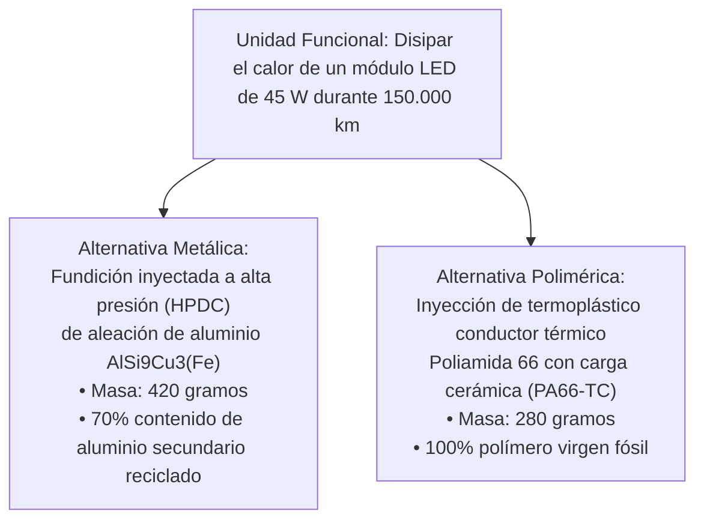
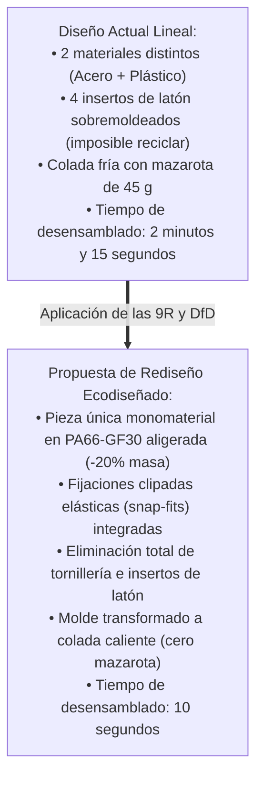

# Unidad 08 · Prácticas, proyectos y rúbricas del sector

Evaluación Integral · RA1–RA6
Cálculos de Taller
Auditoría de Inyección y Fundición
Células Piloto Martos

El aprendizaje de la sostenibilidad en la Formación Profesional de Grado Superior debe fundamentarse en la **resolución de problemas técnicos reales de planta**. En esta unidad se recoge el banco oficial de cuatro prácticas técnicas de laboratorio/taller, las especificaciones del Proyecto Integrador Trimestral de Sostenibilidad y las rúbricas analíticas de evaluación vinculadas a los Resultados de Aprendizaje.

---

## 1. Práctica 1: Auditoría energética y balance de masa en inyectora

### 1.1 Contexto y Datos de Partida
Trabajas como técnico de programación en una empresa proveedora de Martos. La dirección desea auditar una célula de inyección compuesta por una prensa hidráulica de 350 toneladas que fabrica la carcasa trasera de un piloto trasero en polipropileno con 20% de talco (**PP-TD20**).

- **Masa de la pieza inyectada útil:** $360\text{ gramos}$.
- **Masa del canal de colada fría (mazarota):** $58\text{ gramos}$.
- **Número de cavidades del molde:** 2 cavidades.
- **Tiempo de ciclo completo:** $30\text{ segundos}$.
- **Potencia media absorbida de la red por la célula:** $44\text{ kW}$ (incluyendo máquina, atemperador y robot extractor).
- **Producción horaria nominal:** 120 ciclos por hora (240 piezas brutas por hora).
- **Tasa de piezas con defecto de rebaba o rechupado observada:** $4,5\%$.

### 1.2 Tareas a Resolver por el Alumnado
1. **Balance de masa horario:**
   - Calcula la masa total de plástico inyectado por hora.
   - Determina los kilogramos horarios de pieza conforme, los kilogramos de mazarota y los kilogramos de scrap por defectos.
2. **Cálculo del Consumo Específico de Energía ($\text{SEC}$):**
   - Calcula el $\text{SEC}$ considerando únicamente la masa de piezas conformes comercializables ($\text{kWh/kg}$).
   - Calcula el $\text{SEC}$ teórico si el molde se transformara a **colada caliente (*hot runner*) sin mazarota** y se redujera el scrap al $1\%$.
3. **Propuesta técnica de mejora y ahorro económico:**
   - Si la factoría opera 5.500 horas anuales y el coste de la electricidad es de $0,15\text{ €/kWh}$, ¿cuál es el ahorro económico anual si se sustituye la máquina hidráulica por una inyectora eléctrica de $18\text{ kW}$ de potencia media y molde de colada caliente?

---

## 2. Práctica 2: Análisis comparativo de ACV simplificado

### 2.1 Enunciado
Un fabricante de luminarias de automoción en Martos debe seleccionar el material para el disipador térmico de un proyector matricial LED. Se plantean dos alternativas técnicas:

### 2.2 Datos de Inventario y Factores de Emisión
- **Factor de emisión Aluminio primario:** $12,50\text{ kg CO}_2\text{e / kg}$.
- **Factor de emisión Aluminio secundario reciclado:** $0,85\text{ kg CO}_2\text{e / kg}$.
- **Factor de emisión PA66-TC virgen:** $6,40\text{ kg CO}_2\text{e / kg}$.
- **Consumo energético de transformación:**
  - Fundición inyectada de aluminio: $3,2\text{ kWh/kg}$ transformado (Mix eléctrico: $0,25\text{ kg CO}_2\text{e/kWh}$).
  - Inyección de PA66-TC: $1,1\text{ kWh/kg}$ transformado (Mix eléctrico: $0,25\text{ kg CO}_2\text{e/kWh}$).
- **Impacto del peso en la fase de uso del vehículo (150.000 km):** Cada kilogramo adicional de peso en el automóvil genera unas emisiones indirectas de combustible de $0,018\text{ kg CO}_2\text{e / km}$.

### 2.3 Tareas
1. Calcula la huella de carbono total de cada alternativa desglosada en:
   - Emisiones embebidas de materia prima.
   - Emisiones del proceso de moldeo/fundición en planta.
   - Emisiones asociadas a la fase de uso del vehículo debido a la masa del componente.
2. Justifica técnica y ambientalmente cuál es la opción más sostenible según los principios de la economía circular y la directiva de ecodiseño.

---

## 3. Práctica 3: Rediseño ecodiseñado de una pieza y su molde

### 3.1 Reto de Ingeniería de Planta
Dispones del plano técnico de un conjunto de soporte de faro actualmente fabricado en dos piezas:
- Una base en chapa de acero galvanizado estampada ($250\text{ g}$) unida mediante 4 tornillos de acero métrica M5 a una carcasa de poliamida con fibra de vidrio PA6-GF30 ($320\text{ g}$) que incorpora 4 casquillos roscados de latón sobremoldeados.
- El molde actual utiliza un canal de colada fría con un punto de inyección submarino que genera una mazarota de $45\text{ g}$ por ciclo.

### 3.2 Entregables de la Práctica
1. Croquis acotado de la unión clipada (*snap-fit*) calculando la deformación elástica admisible para el montaje sin rotura del plástico.
2. Hoja de instrucciones de desensamblado para operarios de centros de tratamiento de vehículos al final de su vida útil (CAT).
3. Justificación del marcado normalizado según norma **ISO 11469** para su posterior identificación óptica en plantas de reciclado.

---

## 4. Práctica 4: Plan de gestión y valorización de residuos en matricería

### 4.1 Caso Práctico
En un taller de mecanizado y ajuste de moldes de inyección y troqueles de fundición de Martos se generan anualmente:
- $14.000\text{ kg}$ de viruta de acero de mecanizado (empapada en taladrina).
- $3.500\text{ litros}$ de taladrina residual agotada (mezcla agua-aceite al 5%).
- $1.200\text{ litros}$ de aceites hidráulicos usados procedentes de prensas de ajuste.
- $450\text{ kg}$ de trapos y sepiolita impregnados de hidrocarburos.
- $8.000\text{ kg}$ de purgas de arranque de inyectoras de policarbonato y poliamida.

### 4.2 Tareas
1. Clasifica cada uno de los residuos anteriores según el **Catálogo Europeo de Residuos (Lista LER / Código LER)**, distinguiendo residuos peligrosos y no peligrosos.
2. Diseña el protocolo de almacenamiento temporal en planta (cubetos de retención, etiquetado de recipientes, incompatibilidad de mezclas y límite de 6 meses de almacenamiento según la Ley 7/2022).
3. Propón una estrategia de valorización técnica: instalación de una centrífuga escurridora de virutas para recuperar la taladrina limpia y venta de la viruta seca prensada a una fundición siderúrgica andaluza.

---

## 5. Rúbricas Analíticas de Evaluación (RA1 – RA6)

| Resultado de Aprendizaje | Nivel 1 · Insuficiente (1–4) | Nivel 2 · Aceptable (5–6) | Nivel 3 · Notable (7–8) | Nivel 4 · Excelente (9–10) |
|---|---|---|---|---|
| **RA1 · Aspectos ASG y Marcos (15%)** | Confunde conceptos de sostenibilidad; no identifica ODS ni normas CSRD/GRI aplicables a plantas industriales. | Identifica los ODS básicos pero no relaciona los criterios ASG con la cadena de suministro de automoción. | Relaciona con soltura los factores ASG con los riesgos y oportunidades de plantas de moldeo y moldes. | Domina la taxonomía UE, analiza con rigor la doble materialidad y evalúa con solvencia el impacto en OEMs y Tier 1. |
| **RA2 · Retos Sectoriales (15%)** | Desconoce las problemáticas de microplásticos, cuotas de PCR y emisiones en hornos de fundición. | Describe los retos ambientales del plástico y metal pero no propone medidas operativas en planta. | Cuantifica la diferencia energética entre aluminio primario y secundario y formula acciones de mitigación. | Analiza con criterio técnico avanzado los retos del vehículo eléctrico, normativas ELV y descarbonización industrial. |
| **RA3 · Criterios Profesionales (15%)** | Descuida la gestión de residuos y seguridad en el taller de inyección; no aplica criterios de eficiencia. | Aplica pautas básicas de segregación de residuos cuando se le indica explícitamente. | Optimiza los procesos de purga y parada de máquina minimizando el desecho y garantizando la seguridad en prensas. | Lidera buenas prácticas de taller, propone mejoras en consumos auxiliares y promueve la cultura preventiva y ambiental. |
| **RA4 · Ecodiseño y Circularidad (20%)** | Diseña piezas ignorando el desensamblado, genera mazarotas excesivas y desconoce la metodología de ACV. | Comprende el concepto de ecodiseño pero plantea piezas con materiales incompatibles o difícilmente reciclables. | Aplica técnicas de snap-fit, monomaterialidad y calcula inventarios de ciclo de vida con datos reales de catálogo. | Resuelve rediseños complejos de piezas automotrices optimizando masa, eliminando coladas frías y demostrando mejoras con ACV. |
| **RA5 · Tecnologías Limpias (20%)** | No sabe calcular el SEC; desconoce las ventajas de prensas eléctricas y la refrigeración conformada. | Conoce las inyectoras eléctricas pero no justifica su viabilidad técnica ni comprende la normativa AAI. | Calcula con precisión ahorros energéticos ($\text{kWh/kg}$), tiempos de ciclo con conformal cooling y gestiona residuos AAI. | Domina la parametrización de máquinas para polímeros PCR/bioplásticos, hornos eficientes y Mejores Técnicas Disponibles (MTD). |
| **RA6 · Plan e Informe ASG (15%)** | Elabora un plan incompleto sin objetivos cuantificables ni cuadro de mando de indicadores de planta. | Redacta un informe básico con objetivos vagos y justificación financiera insuficiente de las inversiones. | Diseña un plan con objetivos SMART bien formulados, cálculo de Capex/Opex y cuadro de mando operativo de KPIs. | Elabora una auditoría y memoria de sostenibilidad profesional lista para auditoría externa conforme a directivas CSRD/ESRS. |
