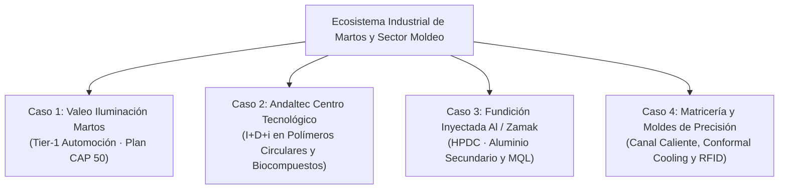
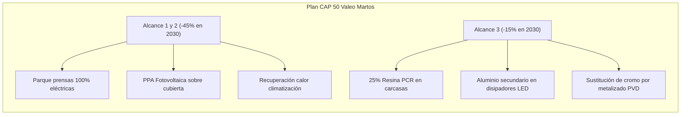
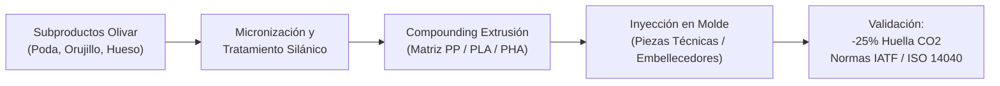
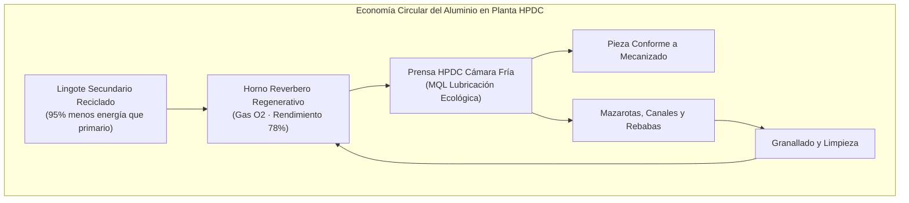
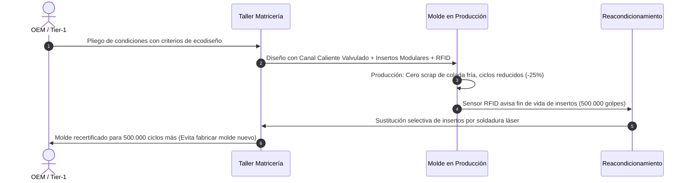

# 09 · Casos Reales de Empresas en Moldeo de Metales y Polímeros

Vinculación Curricular: RA1 · RA2 · RA4 · RA5 · RA6
Clúster Martos & Automoción

En este tema se estudian cuatro casos industriales reales y contextualizados en el polo tecnológico de **Martos (Jaén)** y la industria auxiliar del moldeo de metales y polímeros. Cada caso ilustra la aplicación práctica de los estándares ASG, las tecnologías descarbonizadoras, el ecodiseño y el retorno de inversión ambiental y económico.

---

## Caso 1: Valeo Iluminación Martos — Descarbonización y Plan CAP 50

### Perfil de la Empresa y Contexto
**Valeo Martos** es la mayor factoría de componentes de iluminación para automoción del sur de Europa, con más de 3.000 empleados directos y una producción superior a 30.000 proyectores y pilotos diarios para fabricantes globales (OEM) como Stellantis, Grupo Volkswagen, Renault, BMW y Mercedes-Benz.

Como parte del grupo multinacional Valeo, la factoría de Martos lidera el despliegue del compromiso estratégico **CAP 50**, cuyo objetivo es alcanzar la **neutralidad carbónica neta en 2050**, con metas intermedias vinculantes para 2030:
- Reducción del **45% en emisiones de Alcance 1 y Alcance 2** respecto a 2019.
- Reducción del **15% en emisiones de Alcance 3** (cadena de suministro aguas arriba y uso de producto).

### Líneas de Actuación Técnica en Planta

=== "1. Prensas Servoléctricas y Recuperación Térmica"
    - **Sustitución de maquinaria:** Plan quinquenal de sustitución de 40 prensas hidráulicas de gran tonelaje (400 a 1.200 t) por inyectoras **100% servoléctricas**.
    - **Resultados:** Reducción del Consumo Específico de Energía ($SEC$) de $1{,}45\text{ kWh/kg}$ a $0{,}58\text{ kWh/kg}$ procesado (reducción del 60% de energía eléctrica por pieza). Eliminación de 12.000 litros anuales de aceite hidráulico mineral susceptible de fugas y gestión de residuo peligroso.
    - **Recuperación de calor:** Centralización de las torres de refrigeración de moldes mediante intercambiadores de placas para calentar el aire de ventilación de las naves de montaje en invierno, evitando el encendido de calderas de gas natural.

=== "2. Metalización Sostenible: Del Cromado al PVD Sputtering"
    - **Reto ambiental:** El cromado galvánico tradicional de reflectores utiliza baños de cromo hexavalente ($\text{Cr}^{VI}$), sustancia altamente carcinógena regulada y restringida por el reglamento REACH.
    - **Solución tecnológica:** Implantación de cámaras de **metalizado en alto vacío mediante sputtering térmico (PVD - Physical Vapor Deposition)** de aluminio de alta pureza directamente sobre sustratos de policarbonato (PC) o polibutileno tereftalato (PBT).
    - **Impacto ASG:** Cero vertidos líquidos de efluentes metálicos, reducción del 95% en la huella química de proceso y espesores de capa nanométrica ($< 100\text{ nm}$), con reflectancia lumínica superior al 92%.

=== "3. Cuotas de Reciclado (PCR) en Componentes Estructurales"
    - **Componentes:** Carcasas traseras y soportes interiores no ópticos.
    - **Material:** Sustitución de polipropileno virgen con carga mineral ($\text{PP-TD20}$) por polipropileno reciclado post-consumo ($\text{PCR}$) procedente de parachoques recuperados de centros autorizados de tratamiento de vehículos al final de su vida útil (CATs).
    - **Exigencia técnica:** El equipo de moldeo debió recalibrar perfiles de inyección y contrapresión para amortiguar la variabilidad del índice de fluidez ($\text{MFI}$) del PCR sin generar ráfagas ni rechazos dimensionales.

---

## Caso 2: Andaltec — I+D+i en Polímeros Circulares y Biocompuestos

### Perfil de la Entidad
El **Centro Tecnológico del Plástico (Andaltec)**, ubicado en Martos, es una entidad privada sin ánimo de lucro declarada centro tecnológico nacional. Cuenta con más de 10.000 $\text{m}^2$ de instalaciones científicas, plantas piloto de inyección y laboratorios de ensayos físico-mecánicos, térmicos y reológicos.

Andaltec actúa como motor de transferencia tecnológica para las empresas del sector del moldeo, facilitando la transición hacia la economía circular y la descarbonización.

### Proyectos Emblemáticos de Sostenibilidad

#### 1. Proyecto Biocompuestos del Olivar (Bio-Circularidad Local)
Aprovechando la ubicación en la provincia de Jaén (capital mundial del aceite de oliva), Andaltec desarrolla formulaciones poliméricas donde las cargas minerales tradicionales (talco, carbonato cálcico o fibra de vidrio corta) se sustituyen por **harina de hueso de aceituna micronizada** y fibras lignocelulósicas procedentes de la poda del olivar.
- **Ventaja de sostenibilidad:** Sustitución de hasta un 30% en peso de resina fósil virgen.
- **Balance de carbono:** Las fibras agrícolas actúan como sumidero temporal de carbono biogénico, reduciendo la huella de la pieza en un 28% según ACV cuna a puerta.
- **Desafío técnico en molde:** Ajuste estricto de temperaturas de fundido por debajo de 195 °C para evitar la degradación térmica y emisión de olores y gases volátiles durante el ciclo de plastificación.

#### 2. Ecodiseño de Moldes mediante Conformal Cooling por DMLS
En colaboración con matricerías locales, Andaltec diseña y simula canales de refrigeración conformada (*conformal cooling*) en insertos de moldes para inyección de ópticas complejas de PC y PMMA.
- Fabricación del inserto mediante fusión por lecho de polvo láser (**DMLS** en acero para herramientas 1.2709).
- Refrigeración uniforme que sigue el contorno curvado de la pieza a 2 mm de distancia.
- **Resultados:** Reducción de deformaciones por tensiones residuales (alabeo), disminución del scrap por marcas de hundimiento del 4,2% al 0,3% y reducción del tiempo de enfriamiento de 32 s a 21 s (**-34% de tiempo de ciclo**, con ahorro directo de energía de máquina).

---

## Caso 3: Fundición Inyectada de Aluminio y Zamak (HPDC)

### Perfil Industrial: Fabricación de Disipadores Térmicos para Electrónica LED
En la iluminación automotriz moderna, los módulos LED y los proyectores láser generan alta densidad de calor que requiere disipadores térmicos metálicos con aletas finas de gran superficie. Este caso analiza una planta andaluza de inyección a alta presión (**HPDC - High Pressure Die Casting**) con máquinas de cámara fría de 400 a 800 toneladas para aleaciones $\text{AlSi9Cu3(Fe)}$ y máquinas de cámara caliente para aleación de zinc (**Zamak 5**).

### Medidas de Sostenibilidad y Resultados Técnicos

| Factor de Impacto | Práctica Convencional | Medida de Mejora Sostenible Implantada | Impacto Cuantificado |
| :--- | :--- | :--- | :--- |
| **Huella del metal** | Lingote de aluminio primario electrolítico ($11{,}8\text{ kg CO}_2\text{e/kg Al}$). | 100% Lingote de aluminio secundario post-consumo certificado ($0{,}75\text{ kg CO}_2\text{e/kg Al}$). | **-93,6% de huella de carbono** de producto (Alcance 3 upstream). |
| **Eficiencia de fundición** | Horno de crisol con quemador atmosférico tradicional ($SEC \approx 1{,}2\text{ kWh/kg}$). | Horno reverbero con quemadores regenerativos aire-combustible ($SEC = 0{,}52\text{ kWh/kg}$). | **-56% consumo de gas natural** y reducción de escoria al 1,1%. |
| **Lubricación de molde** | Pulverización de taladrina acuosa grafito/agua ($300\text{ ml/ciclo}$, efluente tóxico). | Micro-pulverización MQL electrostática ($12\text{ ml/ciclo}$ de éster sintético biodegradable). | **-96% consumo de lubricante**, cero efluentes a depuradora, mayor vida útil de molde (+25%). |
| **Circuito cerrado interno** | Venta de mazarotas y desbastes a gestor externo con pérdida de valor. | Retorno directo de coladas limpias al baño fundido en circuito cerrado de planta. | **Tasa de circularidad interna del 98%**, reducción de costes logísticos. |

---

## Caso 4: Matricería y Moldes de Precisión — El Herramental Circular

### Contexto del Taller Auxiliar
El tejido industrial de Martos cuenta con talleres especializados de matricería y moldes de inyección que fabrican herramentales de hasta 15 toneladas para automoción, electrodomésticos y envases técnicos. La sostenibilidad en el taller se enfoca en el ecodiseño del molde a lo largo de todo su ciclo de vida.

### Claves del Ecodiseño en el Herramental

1. **Eliminación sistemática de coladas frías:**
   - Sustitución de bebederos convencionales por **boquillas de canal caliente (*hot runners*) con obturación por aguja neumática/eléctrica**.
   - Para un molde de 4 cavidades de carcasas, se evita la generación de 85 g de ramal por golpe. En una serie de 300.000 piezas, esto representa **25,5 toneladas de polímero virgen ahorradas** y cero consumo energético en triturado y resecado de scrap.

2. **Modularidad y Reparabilidad de Cavidades:**
   - En lugar de mecanizar postizos macizos no reparables, se implementa arquitectura modular de insertos fijados mediante tornillería accesible.
   - Cuando una zona del molde sufre desgaste por fricción o cavitación, se regenera mediante **recargue por soldadura láser micro-pulsada** o deposición térmica, evitando el desecho del bloque de acero de 800 kg.

3. **Pasaporte Digital del Molde (Smart Mold con RFID/NFC):**
   - Integración de un chip sensorizado en la placa base del molde que registra:
     - Contador mecánico y digital de golpes.
     - Histórico de temperaturas máximas de trabajo y ciclos de desmoldeo.
     - Registro de reparaciones, aceros utilizados y huella de carbono embebida de fabricación.
   - Facilita el mantenimiento predictivo antes de que ocurran rebabas o rechazos en la inyectora.

---

## Cuadro Comparativo de Impacto ASG en el Clúster

| Empresa / Caso | Enfoque Principal | Indicador ASG Clave | Reducción de Emisiones | Retorno Económico (Payback) |
| :--- | :--- | :--- | :--- | :--- |
| **Valeo Martos** | Descarbonización global de factoría y producto. | $SEC$ ($\text{kWh/kg}$) y cuota de PCR en pieza. | -45% Alcance 1 y 2 en 2030; -15% Alcance 3. | 3,2 años en inyectoras eléctricas; 1,8 años en PVD. |
| **Andaltec** | I+D+i en materiales biobasados y conformal cooling. | % de carga agrícola local y tiempo de enfriamiento ($t_c$). | -28% $\text{CO}_2$ en resina; -34% energía en moldeado. | Subvencionado en I+D; alto margen tecnológico. |
| **Fundición HPDC** | Fundición circular de aluminio y zamak. | Lingote secundario y consumo de lubricante MQL. | -93,6% $\text{CO}_2$ frente a aluminio primario. | 1,4 años en quemador regenerativo y MQL. |
| **Matricería** | Ecodiseño de moldes, canales calientes y pasaporte digital. | Toneladas de scrap evitadas y reusabilidad del molde. | -100% scrap de colada; duplicación de vida útil. | Directo en ahorro de materia prima para el cliente. |

---

## Actividades Prácticas y Análisis de Casos

### Actividad 9.1 · Auditoría de Cadena de Suministro para Valeo Martos
Un proveedor local de inyección de piezas plásticas suministra soportes de faro a Valeo Martos. Valeo le exige presentar su plan de alineamiento con el compromiso CAP 50 para renovar el contrato de suministro.
1. Identifica qué datos debe recopilar el proveedor para reportar sus emisiones de Alcance 1 y Alcance 2.
2. Propón tres medidas prioritarias que el proveedor debe implementar en sus máquinas inyectoras para reducir su Consumo Específico de Energía en al menos un 25%.
3. Determina cómo impacta en el Alcance 3 de Valeo la decisión del proveedor de adquirir granza de polipropileno con un 30% de contenido reciclado post-consumo (PCR).

### Actividad 9.2 · Viabilidad Técnico-Económica de Biocompuestos de Andaltec
Un fabricante de componentes de automoción evalúa sustituir un soporte inyectado de $\text{PP-GF20}$ (polipropileno virgen con 20% fibra de vidrio) por el biocompuesto de Andaltec $\text{PP-HO20}$ (polipropileno con 20% harina de hueso de aceituna).
- **Datos de producción:** Serie anual de 120.000 piezas. Peso por pieza = 180 g.
- **Coste de materia prima:** PP-GF20 = 2,40 €/kg; PP-HO20 = 1,95 €/kg.
- **Huella de carbono:** PP-GF20 = $2{,}8\text{ kg CO}_2\text{e/kg}$; PP-HO20 = $1{,}6\text{ kg CO}_2\text{e/kg}$.
- **Cálculo solicitado:**
  1. Calcula el ahorro económico anual en coste de resina.
  2. Calcula la reducción anual neta de emisiones de gases de efecto invernadero en toneladas de $\text{CO}_2\text{e}$.
  3. Debate las precauciones que el técnico de producción debe considerar respecto al control de temperatura de la inyectora y la ventilación del molde.
