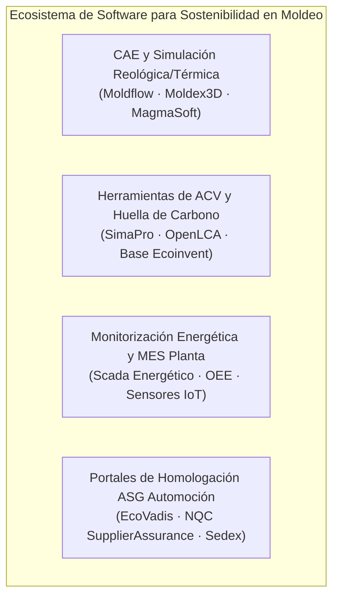

# 10 · Glosario Técnico, Recursos y Bibliografía Especializada

Vinculación Curricular: RA1 · RA2 · RA3 · RA4 · RA5 · RA6
Fabricación Mecánica
Transformación de Polímeros

Este documento recopila la terminología técnica bilingüe (español/inglés) indispensable en la industria moderna del moldeo y la fundición, el compendio regulatorio ambiental europeo y estatal de obligada observancia en planta, los recursos y software sectoriales, y las fuentes bibliográficas de referencia.

---

## Glosario Técnico Especializado (Bilingüe ES / EN)

Aluminio Secundario (*Secondary Aluminum*)
: Aluminio obtenido mediante el reciclaje y refundición de chatarra post-industrial o post-consumo. Su producción consume entre un **90% y un 95% menos energía eléctrica** y emite menos de $1\text{ kg CO}_2\text{e/kg}$ en comparación con el aluminio primario electrolítico procedente de bauxita ($11\text{ a }14\text{ kg CO}_2\text{e/kg}$).

Análisis de Ciclo de Vida (*Life Cycle Assessment - LCA / ACV*)
: Metodología estandarizada por las normas **ISO 14040 e ISO 14044** que cuantifica las entradas (energía, materias primas) y salidas (emisiones al aire, agua, suelo y residuos) de un producto a lo largo de todas sus fases: cuna a puerta (*cradle-to-gate*) o cuna a tumba (*cradle-to-grave*).

Canal Caliente (*Hot Runner System*)
: Sistema de distribución de plástico fundido dentro del molde donde los canales de colada se mantienen a la temperatura de fundición mediante resistencias eléctricas integradas. Al desmoldar la pieza, no se genera colada solidificada ni scrap de bebedero, ahorrando materia prima virgen y energía de triturado.

Canal Frío (*Cold Runner*)
: Sistema convencional de molde en el que el polímero solidifica tanto en la cavidad de la pieza como en los canales de distribución y bebedero. Requiere desmoldeo mecánico de la colada, corte, triturado y reincorporación como regranulado o gestión como scrap.

Compromiso CAP 50 (*Valeo Carbon Neutrality Plan*)
: Estrategia corporativa del grupo Valeo para alcanzar la neutralidad carbónica en 2050, con metas vinculantes para 2030 de reducir un 45% las emisiones en Alcances 1 y 2, y un 15% en Alcance 3 en su cadena de suministro global.

Consumo Específico de Energía (*Specific Energy Consumption - SEC*)
: Indicador clave de eficiencia energética de proceso definido como el cociente entre la energía eléctrica o térmica consumida ($E$ en kWh) y la masa de material conforme procesado ($M$ en kg): $\text{SEC} = E / M$.

Desmoldeante Ecológico / MQL (*Minimum Quantity Lubrication*)
: Sistema de lubricación de las cavidades del molde metálico (en fundición inyectada HPDC) que sustituye la pulverización masiva de emulsiones agua-aceite por microgotas pulverizadas electrostáticamente de ésteres biodegradables de alta viscosidad, reduciendo el consumo de líquido en más del 90% y suprimiendo efluentes contaminantes.

Doble Materialidad (*Double Materiality*)
: Principio rector de la directiva europea **CSRD** y los estándares **ESRS** que exige evaluar tanto la **materialidad de impacto** (cómo las actividades de moldeo de la planta afectan al medio ambiente y a la sociedad) como la **materialidad financiera** (cómo los riesgos climáticos y normativos afectan a la rentabilidad y viabilidad del negocio).

Escoria / Borra (*Dross / Slag*)
: Capa superficial de óxidos metálicos, fundentes e impurezas que se forma sobre el baño fundido en los hornos de mantenimiento y fusión de aluminio o zamak. Requiere tratamiento metalúrgico mediante desgasificado y espumado para minimizar la pérdida de metal noble atrapado antes de su retirada.

Fundición Inyectada a Alta Presión (*High Pressure Die Casting - HPDC*)
: Proceso de conformación en el que un metal fundido (aleaciones de aluminio, magnesio o zamak) se introduce en una matriz de acero templado a alta velocidad (30 a 100 m/s) y bajo presiones muy elevadas (300 a 1.200 bar), logrando geometrías de pared delgada y tolerancias dimensionales estrechas.

Horno Reverbero Regenerativo (*Regenerative Reverberatory Furnace*)
: Horno de fundición de aluminio donde los gases de combustión calientes atraviesan lechos cerámicos que precalientan el aire de combustión entrante a más de 800 °C, alcanzando eficiencias térmicas superiores al 75% frente al 40% de los hornos tradicionales de crisol.

Huella de Carbono de Producto (*Product Carbon Footprint - CFP*)
: Suma total de las emisiones de gases de efecto invernadero (GEI) generadas durante el ciclo de vida de una pieza inyectada, expresada en kilogramos de dióxido de carbono equivalente ($\text{kg CO}_2\text{e}$) según la norma **ISO 14067**.

Metalizado PVD / Sputtering (*Physical Vapor Deposition*)
: Proceso limpio de deposición física en fase vapor bajo vacío que sustituye al cromado galvánico electrolítico. El aluminio o titanio puro es evaporado y condensado sobre el sustrato polimérico (PC/PBT), eliminando el uso de baños químicos de cromo hexavalente ($\text{Cr}^{VI}$) y vertidos acuosos peligrosos.

Mazarota y Bebedero (*Sprue and Riser*)
: Conductos y depósitos auxiliares en moldes de fundición que alimentan de metal líquido la cavidad para compensar la contracción durante la solidificación. En una planta circular, se reciclan al 100% en el propio horno de fusión de planta (*closed loop*).

Operación Limpieza de Granza (*Operation Clean Sweep - OCS*)
: Programa internacional voluntario de la industria del plástico cuyo objetivo es prevenir la fuga accidental de granza (pellets), escamas y polvo de resina al medio ambiente y a las redes de saneamiento pluvial en todas las etapas de recepción, secado y transporte neumático en planta.

PCR (*Post-Consumer Recycled*)
: Material polimérico recuperado de productos que han completado su vida útil en manos del consumidor final (por ejemplo, parachoques de vehículos en desguaces o botellas recogidas selectivamente), clasificado, lavado y regranulado para su reinserción industrial.

PIR (*Post-Industrial Recycled*)
: Residuo plástico generado en el propio proceso de fabricación (mermas de puesta a punto, piezas defectuosas, canales fríos) que no ha salido al mercado y que se reprocesa directamente en la misma o en otra planta transformadora.

Prensa Servoléctrica (*All-Electric Injection Molding Machine*)
: Máquina de inyección cuyos movimientos (cierre de molde, inyección, dosificación y expulsión) son accionados por servomotores eléctricos independientes de control vectorial, prescindiendo del grupo hidráulico central y del aceite mineral. Reduce el consumo energético entre un 50% y un 70%.

Refrigeración Conformada (*Conformal Cooling*)
: Canales de refrigeración fabricados mediante manufactura aditiva metálica (**DMLS / SLM**) en insertos de moldes que copian exactamente la curvatura geométrica tridimensional de la cavidad a una distancia constante, eliminando puntos calientes, alabeos y reduciendo el tiempo de enfriamiento hasta en un 40%.

Regranulado (*Regrind*)
: Material triturado procedente de mermas de inyección (coladas, rebabas o piezas defectuosas) que se mezcla en porcentajes dosificados (típicamente del 10% al 30%) con granza virgen en la tolva de la inyectora.

Scrap Rate (*Tasa de Rechazo / Chatarra*)
: Porcentaje de piezas no conformes o material residual generado respecto al total de material procesado: $\text{Scrap Rate} = (\text{Masa Rechazo} / \text{Masa Total Alimentada}) \times 100$.

Taxonomía Europea (*EU Taxonomy - Reglamento UE 2020/852*)
: Sistema de clasificación de la Unión Europea que define qué actividades industriales son técnicamente sostenibles según seis objetivos ambientales (mitigación climática, adaptación, economía circular, prevención de contaminación, agua y biodiversidad) bajo el principio de **No Causar Daño Significativo (DNSH)**.

Zamak
: Familia de aleaciones de zinc con aluminio (aprox. 4%), magnesio y cobre, caracterizada por su bajo punto de fusión (aprox. 385 °C), excelente fluidez para moldeo en cámara caliente, alta reciclabilidad al 100% y óptima conductividad eléctrica y apantallamiento electromagnético.

---

## Compendio Normativo y Legislativo Aplicable

| Norma / Disposición Legal | Ámbito Geográfico | Aplicación en Planta de Moldeo de Metales y Polímeros |
| :--- | :--- | :--- |
| **Ley 7/2022 de Residuos y Suelos Contaminados** | España (Estatal) | Regula la jerarquía de residuos, el impuesto especial sobre envases de plástico no reutilizables (0,45 €/kg) y la obligación de gestión separada y trazabilidad digital de mermas y residuos peligrosos (taladrinas, aceites, lodos). |
| **Directiva CSRD (UE) 2022/2464 y Normas ESRS** | Unión Europea | Obliga al reporte de sostenibilidad bajo estándares ESRS (E1 Cambio Climático, E2 Contaminación, E5 Uso de Recursos y Economía Circular). Afecta directamente a empresas Tier-1 (Valeo) y en cascada a sus subcontratistas. |
| **Propuesta de Reglamento ELV (End-of-Life Vehicles)** | Unión Europea | Exigencia legal de incorporar al menos un **25% de plásticos reciclados (con un 25% procedente de vehículos cerrados)** en cada nuevo vehículo homologado a partir de 2030. Impacto directo en especificaciones de piezas inyectadas. |
| **Reglamento REACH (CE 1907/2006)** | Unión Europea | Registro y restricción de sustancias químicas peligrosas: prohibición progresiva de desmoldeantes fluorados (PFAS) y sustitución del cromo hexavalente ($\text{Cr}^{VI}$) por tecnologías limpias (PVD). |
| **ISO 14001:2015** | Internacional | Sistema de Gestión Ambiental en planta: matriz de identificación y evaluación de aspectos e impactos ambientales significativos (ruido, vertidos, emisiones a la atmósfera, residuos). |
| **ISO 50001:2018** | Internacional | Sistema de Gestión de la Energía: establecimiento de Líneas Base Energéticas (LBE) y seguimiento de Indicadores de Desempeño Energético (IDEn) en kW y kWh/kg en prensas y hornos. |
| **ISO 14006:2020** | Internacional | Directrices para incorporar el **Ecodiseño** en el diseño y desarrollo de piezas plásticas, matrices y moldes de inyección. |
| **IATF 16949:2016** | Internacional Automoción | Norma de calidad para la cadena de suministro de automoción, que integra cláusulas estrictas sobre planes de contingencia ambiental, trazabilidad de materias primas y homologación de granza reciclada. |
| **ISO 11469 e ISO 1043** | Internacional | Codificación y marcado normalizado de componentes plásticos para facilitar su identificación y reciclabilidad al desguace (ejemplo: `>PP-TD20<`, `>PC<`, `>PBT-GF30<`). |

---

## Software, Herramientas Digitales y Bases de Datos Sectoriales

### 1. Simulación Reológica, Térmica y de Llenado
- **Autodesk Moldflow / Moldex3D:** Software de simulación de inyección plástica. Permite predecir líneas de soldadura, contracciones, alabeos y optimizar la ventana de proceso. Permite simular el comportamiento de resinas PCR con MFI disperso y diseñar sistemas de canal caliente y refrigeración conformada, reduciendo la necesidad de pruebas físicas en máquina y mermas de puesta a punto.
- **MAGMASoft / ProCAST:** Simulación de fundición inyectada a alta presión (HPDC). Modela el llenado turbulento, atrapamiento de aire y solidificación de aleaciones de aluminio y zamak, permitiendo optimizar el diseño de mazarotas y canales para maximizar el rendimiento metálico.

### 2. Software y Bases de Datos de Análisis de Ciclo de Vida (ACV)
- **OpenLCA:** Software de código abierto para cálculo de ACV compatible con bases de datos internacionales.
- **SimaPro:** Herramienta profesional de ACV utilizada por centros tecnológicos como Andaltec para modelar perfiles de huella ambiental de producto según PEF (Product Environmental Footprint).
- **Base de Datos Ecoinvent (v3.9+):** Contiene inventarios de ciclo de vida desagregados para polímeros vírgenes (PC, PMMA, PA66, PP), polímeros reciclados (rPP, rPET), aluminio electrolítico primario y aluminio secundario europeo.

### 3. Plataformas de Evaluación ASG en la Cadena de Suministro del Automóvil
- **NQC SupplierAssurance / Drive Sustainability:** Cuestionario SAQ 5.0 obligatorio para proveedores de Stellantis, BMW, Volkswagen, Renault y Valeo para verificar cumplimiento en derechos laborales, ética, huella de carbono y descarbonización.
- **EcoVadis:** Plataforma global de calificación de sostenibilidad corporativa (medallas Platino, Oro, Plata, Bronce) basada en 21 criterios agrupados en Medio Ambiente, Prácticas Laborales, Ética y Compras Sostenibles.

---

## Bibliografía y Fuentes de Información Recomendadas

1. **Grisel, M. & Harscoët, E. (2023).** *Plastics Processing and the Circular Economy: Technologies, Design and Recycling*. Hanser Publications.
2. **Kaufmann, H. & Wabusseg, H. (2022).** *High Pressure Die Casting of Aluminium and Magnesium Alloys*. Springer Vieweg.
3. **Throne, J. L. & Rosato, D. V. (2021).** *Injection Molding Handbook* (4th Edition). Kluwer Academic Publishers.
4. **Asociación Española de Normalización (UNE). (2020).** *Norma UNE-EN ISO 14006: Sistemas de gestión ambiental. Directrices para incorporar el ecodiseño*. AENOR.
5. **Andaltec (Centro Tecnológico del Plástico).** *Memorias anuales de I+D+i en materiales biobasados, economía circular y aligeramiento estructural*. Publicaciones técnicas de Andaltec (Martos, Jaén).
6. **Valeo Group.** *Universal Registration Document & Sustainability Report (Integrated Report)*. Publicado anualmente conforme a CSRD y NFRD.
7. **European Aluminium Association.** *Circular Aluminium Action Plan 2030: Executive Summary and Environmental Factsheets*. Bruselas.
8. **Plastics Europe & AIMPLAS.** *Informe Anual sobre la Economía Circular de los Plásticos en España y Europa*.
9. **Ministerio para la Transición Ecológica y el Reto Demográfico (MITECO).** *Guía para el cálculo de la huella de carbono y para la elaboración de un plan de mejora de reducción de emisiones de gases de efecto invernadero*. Gobierno de España.
