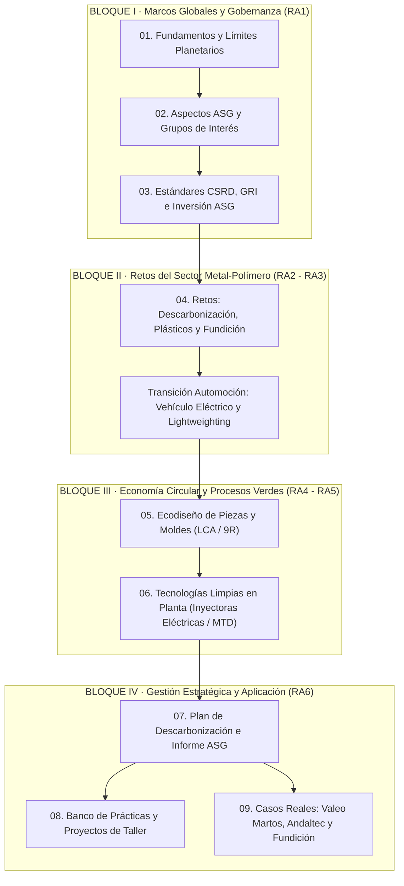

# Sostenibilidad aplicada al sistema productivo

Módulo 1708 (30h / 3 ECTS)
Transformación de Polímeros
Moldeo y Fundición Metálica
Ecosistema Industrial Martos

Material didáctico y guía de referencia del módulo profesional **Sostenibilidad aplicada al sistema productivo** (Código **1708**), impartido en el primer curso del ciclo de **Técnico Superior en Programación de la Producción en Moldeo de Metales y Polímeros** (Familia Profesional de *Fabricación Mecánica*), en el polo industrial de **Martos (Jaén)**.

El contenido articula las exigencias de la transición ecológica europea y los marcos ASG con la realidad productiva de las plantas de inyección de termoplásticos técnicos, matricería de precisión y fundición inyectada de metales no férreos (aluminio y zamak), tomando como referencia las cadenas de suministro de componentes de automoción y alumbrado técnico (clúster de **Valeo Martos**, centro tecnológico **Andaltec** y empresas auxiliares del metal y plástico).

---

## 1. Ficha curricular del módulo

| Parámetro | Detalle normativo y organizativo |
|---|---|
| **Módulo Profesional** | Sostenibilidad aplicada al sistema productivo |
| **Código oficial** | **1708** |
| **Ciclo Formativo** | Técnico Superior en Programación de la Producción en Moldeo de Metales y Polímeros |
| **Familia Profesional** | Fabricación Mecánica (RD 882/2011, de 24 de junio) |
| **Marco regulador del módulo** | Ley Orgánica 3/2022 y Real Decreto 659/2023, de 18 de julio (Anexo VIII) |
| **Carga horaria y créditos** | 30 horas lectivas presenciales (3 créditos ECTS) |
| **Curso y temporalización** | 1.º Curso académico (1 hora semanal / anual, cursos 2025/2026 y 2026/2027) |
| **Contexto socioproductivo** | Martos (Jaén) · Clúster de automoción, inyección de plástico y moldeo metálico |

---

## 2. Mapa conceptual del módulo en moldeo

---

## 3. Estructura de las unidades de aprendizaje

=== "Bloque 1: Fundamentos y Gobernanza (RA1)"

    - **[01. Fundamentos de la sostenibilidad](01-fundamentos-sostenibilidad.md):** Límites planetarios, Antropoceno, ODS aplicados al sector industrial (ODS 9, 12 y 13), Pacto Verde Europeo y Taxonomía ambiental.
    - **[02. Aspectos ASG y grupos de interés](02-aspectos-ASG-y-grupos-de-interes.md):** Factores ambientales (consumos, emisiones, mazarotas, VOCs), sociales (seguridad en planta, humos, prensas de alto tonelaje) y gobernanza. Matriz de doble materialidad.
    - **[03. Estándares, métricas e inversión responsable](03-estandares-metricas-e-inversion-responsable.md):** Normas CSRD/ESRS, estándares GRI (301, 302, 305, 306), ISO 14001, ISO 50001, GHG Protocol (Alcances 1, 2 y 3) y KPIs de planta (kWh/kg transformado, tasa de scrap).

=== "Bloque 2: Retos del Sector (RA2 - RA3)"

    - **[04. Retos ambientales y sociales en moldeo](04-retos-ambientales-y-sociales-moldeo-metales-polimeros.md):** Regulación de microplásticos, cuotas de plástico reciclado obligatorio en vehículos (Directiva ELV), huella de carbono de la fundición de aluminio primario vs secundario, desmoldeantes, lubricantes y reconversión de la industria del automóvil.

=== "Bloque 3: Circularidad y Procesos (RA4 - RA5)"

    - **[05. Economía circular, verde y ecodiseño](05-economia-circular-verde-y-ecodisenio.md):** Las 9R en piezas inyectadas, ecodiseño para el desensamblaje (*snap-fits*), monomaterialidad en ópticas, canales calientes (*hot runners*), optimización topológica y Análisis de Ciclo de Vida (LCA / ISO 14040).
    - **[06. Actividades y tecnologías sostenibles](06-actividades-sostenibles-moldeo-metales-polimeros.md):** Prensas de inyección 100% eléctricas vs hidráulicas, refrigeración conformada (*conformal cooling*), procesado de polímeros PCR y bioplásticos, hornos de fusión de alta eficiencia, Autorización Ambiental Integrada (AAI) y mejores técnicas disponibles (MTD/BAT).

=== "Bloque 4: Aplicación Práctica e Industria (RA6)"

    - **[07. Plan de sostenibilidad e informe](07-plan-sostenibilidad-e-informe.md):** Diagnóstico de planta, definición de objetivos SMART, planes de inversión (Capex/Opex), cuadro de mando e informe de sostenibilidad corporativa.
    - **[08. Prácticas y proyectos industriales](08-practicas-y-trabajos-moldeo-metales-polimeros.md):** Auditoría energética de una célula de inyección, comparativa de ACV plástico vs aluminio, gestión de residuos y proyecto de descarbonización.
    - **[09. Casos de empresas del sector](09-casos-empresas-moldeo-metales-polimeros.md):** Estudio a fondo de *Valeo Iluminación Martos* (plan CAP 50, metalizado por vacío ecológico), *Andaltec* (I+D en biopolímeros y reciclado químico) y fundiciones de automoción en Andalucía.
    - **[10. Glosario, recursos y bibliografía](10-glosario-recursos-bibliografia.md):** Diccionario técnico bilingüe (ES/EN), normativa ambiental europea y estatal, y guías de referencia.

---

## 4. Metodología y enfoque pedagógico

!!! tip "Criterio de actuación en planta"

    Un Técnico Superior en Programación de la Producción en Moldeo no es un mero ejecutor de parámetros de inyección; es el responsable directo de optimizar los tiempos de ciclo, minimizar el consumo energético por kilogramo de material transformado, eliminar los defectos que generan piezas defectuosas (*scrap*) y garantizar el uso seguro y eficiente de materias primas secundarias y recicladas.

!!! note "Vinculación con la FP Dual en Martos"

    Las actividades y proyectos de este módulo están coordinados con los periodos de formación en empresa en las industrias del polígono industrial de Martos y comarca, permitiendo al alumnado aplicar directamente las auditorías de energía, residuos y ecodiseño sobre células reales de producción.
