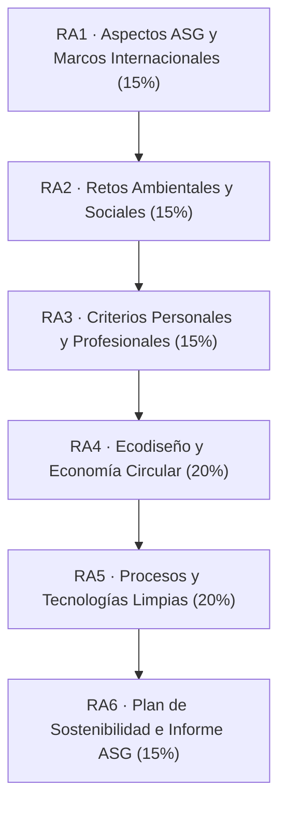
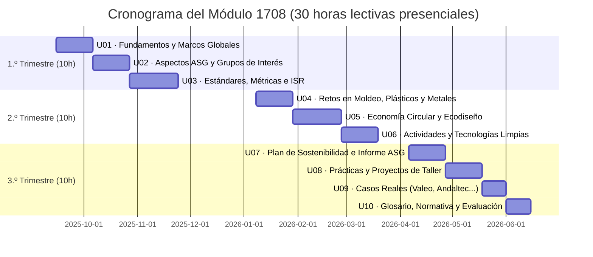
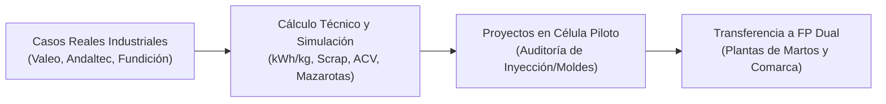
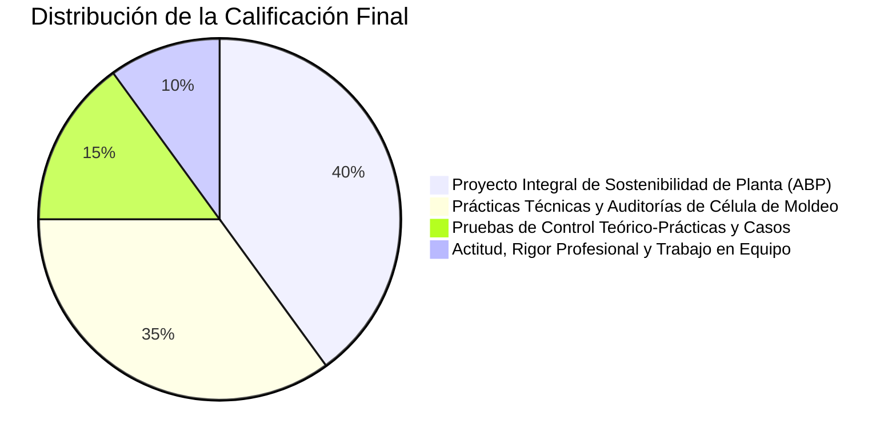

# Programación Didáctica

Módulo Profesional 1708
Moldeo de Metales y Polímeros
Familia Fabricación Mecánica
IES Fernando III · Martos

**Módulo:** Sostenibilidad aplicada al sistema productivo (Código: 1708)  
**Ciclo Formativo:** Técnico Superior en Programación de la Producción en Moldeo de Metales y Polímeros  
**Nivel Educativo:** Formación Profesional de Grado Superior (CINE-5b / EQF-5)  
**Familia Profesional:** Fabricación Mecánica  
**Duración Total:** 30 horas lectivas (3 créditos ECTS)  
**Curso Académico:** 2025/2026 – 2026/2027 (1.º Curso, 1 hora lectiva semanal)  
**Centro Docente:** IES Fernando III / Red de Centros de FP de Martos (Jaén)  

---

## 1. Justificación y Marco Normativo

La aprobación de la **Ley Orgánica 3/2022**, de 31 de marzo, de ordenación e integración de la Formación Profesional, y el **Real Decreto 659/2023**, de 18 de julio, establecen una transformación estructural del sistema formativo español, incorporando con carácter transversal el módulo profesional de **Sostenibilidad aplicada al sistema productivo** (Código 1708) en todos los ciclos formativos de Grado Medio y Grado Superior.

El **Artículo 100** del Real Decreto 659/2023 define la finalidad esencial del módulo:
> *«El módulo de Sostenibilidad aplicada al sistema productivo tendrá como finalidad el desarrollo de conocimiento y competencias básicas en economía verde, sostenibilidad e impacto ambiental de la actividad, así como las condiciones en que las exigencias de la transición ecológica modifican los procesos productivos del sector correspondiente.»*

### 1.1 Contextualización sectorial en el polo industrial de Martos

El ciclo de **Técnico Superior en Programación de la Producción en Moldeo de Metales y Polímeros** (regulado por el **Real Decreto 882/2011**, de 24 de junio) capacita a los profesionales responsables de planificar, programar y controlar la fabricación en plantas de **transformación de termoplásticos y termoestables**, **matricería y moldes**, y **fundición inyectada de aleaciones no férreas (aluminio y zamak)**.

La impartición del ciclo en **Martos (Jaén)** sitúa esta programación en un entorno productivo de excepcional intensidad tecnológica:
1. **Polo de Iluminación y Plásticos de Automoción:** Presencia de la multinacional **Valeo Iluminación Martos**, líder global en diseño y fabricación de sistemas de alumbrado de automoción (faros, pilotos, proyectores LED, electrónica y carcasas plásticas/metálicas), comprometida con planes de descarbonización extrema (*Valeo CAP 50*).
2. **Centro Tecnológico Andaltec:** Fundación y centro tecnológico de referencia europea en I+D para el sector del plástico, ecodiseño, materiales poliméricos bio-basados y reciclado avanzado.
3. **Red auxiliar de matricería y fundición:** Talleres especializados en diseño y mecanizado de moldes de inyección, prensas de estampación y células de fundición a alta presión (*High Pressure Die Casting - HPDC*) de aluminio y zamak para componentes de disipación térmica y estructurales.

En este marco, la sostenibilidad no es una asignatura teórica desvinculada del taller; es la variable operativa que define la competitividad de las plantas: reducción del consumo eléctrico por kilogramo inyectado ($\text{kWh/kg}$), eliminación del desecho (*zero scrap*), gestión circular de mazarotas y purgas, sustitución de colada fría por colada caliente (*hot runners*), y cumplimiento de los estándares IATF 16949, ISO 14001 e ISO 50001.

---

## 2. Resultados de Aprendizaje y Criterios de Evaluación

El currículo oficial del módulo está fijado en el **Anexo VIII** del Real Decreto 659/2023. Se compone de 6 Resultados de Aprendizaje (RA):

### Tabla de ponderación y desglose de criterios

| Resultado de Aprendizaje (RA) | Peso | Criterios de Evaluación Oficiales (RD 659/2023, Anexo VIII) | Enfoque aplicativo en Moldeo de Metales y Polímeros |
|---|:---:|---|---|
| **RA1. Identifica los aspectos ambientales, sociales y de gobernanza (ASG)** relativos a la sostenibilidad teniendo en cuenta el desarrollo sostenible y los marcos internacionales. | **15%** | **a)** Concepto de sostenibilidad y marcos internacionales. **b)** Asuntos ASG en organizaciones empresariales. **c)** ODS y Agenda 2030. **d)** Grupos de interés, riesgos y oportunidades ASG. **e)** Estándares de métricas (CSRD/ESRS, GRI) y rendición de cuentas. **f)** Inversión socialmente responsable (ISR) y agencias de rating. | Aplicación de los ODS 9, 12 y 13 a plantas de moldeo. Análisis de expectativas ASG de fabricantes automotrices (OEMs) sobre proveedores Tier 1 (Valeo) y Tier 2 (matricerías). |
| **RA2. Caracteriza los retos ambientales y sociales** a los que se enfrenta la sociedad, describiendo impactos sobre personas y sectores productivos y proponiendo acciones de minimización. | **15%** | **a)** Retos ambientales y sociales globales. **b)** Relación con el desarrollo de la actividad económica. **c)** Impactos sobre personas y sectores productivos. **d)** Medidas y acciones de mitigación y adaptación. **e)** Alianzas estratégicas y trabajo transversal. | Directiva europea de plásticos de un solo uso (SUP), objetivo de 25% de polímero reciclado en vehículos (propuesta ELV), emisiones de hornos de fundición de aluminio y humos de inyección. |
| **RA3. Establece la aplicación de criterios de sostenibilidad** en el desempeño profesional y personal, identificando los elementos necesarios. | **15%** | **a)** ODS más relevantes para la actividad profesional. **b)** Riesgos y oportunidades de los ODS en el puesto. **c)** Acciones desde la actividad profesional y personal. | Protocolos de segregación de granza virgen vs triturada, reducción de paradas de máquina, uso eficiente de fluidos de corte y seguridad en el cambio de molde. |
| **RA4. Propón productos y servicios responsables** teniendo en cuenta los principios de la economía circular. | **20%** | **a)** Modelo clásico de producción y consumo lineal. **b)** Principios de economía verde y circular. **c)** Beneficios del modelo circular frente al lineal. **d)** Principios de ecodiseño en producto. **e)** Análisis del Ciclo de Vida (LCA / ACV). **f)** Criterios de sostenibilidad en procesos de producción. | Ecodiseño de componentes inyectados: monomaterialidad en ópticas, snap-fits para desensamblado rápido, reducción de espesores de pared (*lightweighting*) y cálculo de huella de carbono de ciclo de vida (ISO 14040). |
| **RA5. Realiza actividades sostenibles** minimizando el impacto de las mismas en el medio ambiente. | **20%** | **a-c)** Modelo de producción, economía circular y beneficios. **d)** Evaluación del impacto de actividades. **e)** Aplicación de principios de ecodiseño. **f)** Estrategias sostenibles en planta. **g)** Ciclo de vida del producto. **h)** Procesos de producción sostenibles. **i)** Normativa ambiental aplicable. | Eficiencia energética en inyectoras eléctricas vs hidráulicas, refrigeración conformada (*conformal cooling*), procesado de polímeros PCR y bioplásticos, tratamiento de taladrinas y Autorización Ambiental Integrada (AAI). |
| **RA6. Analiza un plan de sostenibilidad de una empresa del sector**, identificando grupos de interés, aspectos materiales y justificando acciones y métricas. | **15%** | **a)** Grupos de interés de la empresa. **b)** Aspectos ASG materiales y matriz de materialidad. **c)** Acciones de minimización de impactos y oportunidades. **d)** Métricas de desempeño según estándares internacionales. **e)** Elaboración del informe de sostenibilidad corporativo. | Elaboración de una auditoría y plan de sostenibilidad para una planta de inyección o fundición en Martos, con cálculo de KPIs industriales ($\text{kWh/kg}$, % scrap) y memoria de descarbonización. |

---

## 3. Organización de las Unidades Didácticas y Temporalización

El módulo se imparte a razón de **1 hora semanal** durante las 30 semanas del curso académico (1.º curso), distribuidas en 10 Unidades Didácticas agrupadas en tres trimestres:

### Detalle de contenidos por unidad

#### Trimestre 1: Marcos de Sostenibilidad y Gobernanza Industrial (10 horas)
* **UD 01 · Fundamentos de la sostenibilidad y marcos internacionales (3h):**
  Límites biofísicos del planeta y cambio climático. Antropoceno y huella ecológica industrial. Los 17 ODS y su aterrizaje en el sector secundario (ODS 9 Industria, ODS 12 Consumo y producción responsables, ODS 13 Acción climática). El Pacto Verde Europeo (*European Green Deal*) y la Taxonomía Ambiental de la UE.
* **UD 02 · Aspectos ASG y grupos de interés en plantas de moldeo (3h):**
  La triple dimensión ASG. Pilar Ambiental: materias primas (polímeros fósiles, chatarra de aluminio), consumos de energía eléctrica y térmica, emisiones de CO2 y compuestos orgánicos volátiles (VOCs) en desmoldeantes y barnices. Pilar Social: seguridad y salud laboral (humos de inyección, riesgos de aplastamiento en prensas, ergonomía, quemaduras en fundición), impacto socioeconómico en Martos. Pilar Gobernanza: cumplimiento normativo (*compliance*), auditorías IATF 16949 y cadena de suministro. Matriz de doble materialidad.
* **UD 03 · Estándares de reporte, métricas de sostenibilidad e inversión responsable (4h):**
  Marco regulatorio europeo: Directiva CSRD y normas ESRS (*European Sustainability Reporting Standards*). Estándares GRI (GRI 301 Materiales, 302 Energía, 305 Emisiones, 306 Residuos). Estándares de gestión: ISO 14001 (Gestión ambiental) e ISO 50001 (Eficiencia energética). Protocolo GHG y los 3 alcances de emisión. Métricas específicas de taller: consumo específico de energía ($\text{kWh/kg}$ transformado), tasa de scrap (% rechazo) y tasa de reincorporación de triturado (% regrind). Finanzas sostenibles y fondos NextGenerationEU.

#### Trimestre 2: Retos Sectoriales, Circularidad y Tecnologías Limpias (10 horas)
* **UD 04 · Retos ambientales y sociales del moldeo de metales y polímeros (3h):**
  El reto de los polímeros: problemática de los microplásticos, directiva europea de plásticos de un solo uso (SUP) y nueva regulación de vehículos al final de su vida útil (cuota obligatoria del 25% de plástico reciclado post-consumo en turismos nuevos). El reto de la fundición metálica: alta intensidad energética de hornos de fusión de aluminio y zamak; huella de carbono de metales primarios frente a secundarios reciclados (ahorro energético del 95% en aluminio secundario). Emisiones de escorias, cascarillas y fluidos de corte en matricería. Transición del sector automotriz hacia el vehículo eléctrico y aligeramiento estructural (*lightweighting*).
* **UD 05 · Economía circular, procesos verdes y ecodiseño en piezas moldeadas (4h):**
  El modelo lineal («extraer, moldear, tirar») vs el modelo circular. Estrategia de las 9R en piezas inyectadas. Metodología de ecodiseño (Directiva de Ecodiseño para Productos Sostenibles - ESPR): diseño para desensamblado (*Design for Disassembly*), uniones clipadas (*snap-fit*) frente a tornillería metálica sobremoldeada, monomaterialidad en proyectores y carcasas, uniformidad de espesores para reducir ciclo y material. Moldes de colada caliente (*hot runners*) para eliminar desecho de canal frío. Optimización topológica en fundición inyectada de aluminio. Análisis de Ciclo de Vida (LCA / ISO 14040): cálculo de huella de carbono de la cuna a la tumba.
* **UD 06 · Actividades y tecnologías sostenibles en moldeo y matricería (3h):**
  Eficiencia en maquinaria: comparativa técnica y energética entre prensas de inyección hidráulicas y prensas 100% eléctricas (reducción del 50-70% de energía, eliminación de aceites hidráulicos). Climatización y refrigeración de moldes: canales de refrigeración conformada (*conformal cooling*) mediante fabricación aditiva metálica (DMLS). Polímeros sostenibles: termoplásticos reciclados post-consumo (PCR) y post-industriales (PIR), bioplásticos técnicos y control de procesabilidad (deshumidificación, viscosidad, reología). Hornos de mantenimiento de fundición de alta eficiencia y quemadores recuperativos. Legislación ambiental aplicable: Autorización Ambiental Integrada (AAI), Ley 7/2022 de residuos, reglamento REACH y Mejores Técnicas Disponibles (MTD/BAT).

#### Trimestre 3: Plan Estratégico, Prácticas y Transferencia Industrial (10 horas)
* **UD 07 · Plan de sostenibilidad e informe de desempeño ASG (3h):**
  Estructura de un plan de sostenibilidad en una empresa del sector: diagnóstico inicial de planta, definición de compromisos y objetivos SMART (reducción de emisiones netas, tasa zero-scrap, 100% energía renovable). Plan de descarbonización e inversiones Capex/Opex (fotovoltaica en cubierta, recuperación de calor residual de compresores e inyectoras). Cuadro de mando integral con indicadores de proceso. Elaboración del informe de sostenibilidad según el formato del Estado de Información No Financiera (EINF).
* **UD 08 · Prácticas de laboratorio, proyectos y rúbricas del sector (3h):**
  Desarrollo guiado del banco de prácticas del técnico de producción:
  - Práctica 1: Auditoría de balance de materia y energía en una inyectora de termoplásticos de 300 t.
  - Práctica 2: Análisis comparativo de ACV simplificado: carcasa de proyector en policarbonato virgen vs policarbonato PCR reciclado vs fundición de zamak.
  - Práctica 3: Rediseño ecodiseñado de una pieza automotriz para eliminar mazarotas y reducir masa en un 15%.
  - Práctica 4: Plan de minimización y valorización de residuos en un taller de matricería y fundición.
* **UD 09 · Casos de empresas de moldeo, automoción y polímeros (2h):**
  Análisis exhaustivo de empresas líderes:
  - *Caso Valeo Iluminación Martos:* Estrategia *CAP 50*, desarrollo de ópticas ecológicas, metalizado de proyectores por evaporación al vacío de bajo impacto, sustitución de maquinaria por inyectoras eléctricas inteligentes.
  - *Caso Andaltec (Centro Tecnológico del Plástico, Martos):* Proyectos europeos de circularidad, biocomposites para el automóvil y tecnologías de reciclado avanzado.
  - *Caso Fundición de Aluminio Automotriz en Andalucía:* Plantas de fundición a alta presión (HPDC) que operan con 100% de aleaciones secundarias recicladas.
* **UD 10 · Glosario técnico, marco normativo consolidado y evaluación final (2h):**
  Consolidación terminológica bilingüe (español/inglés) indispensable en entornos industriales multinacionales. Revisión de la legislación ambiental y presentación pública del proyecto final de sostenibilidad aplicada a planta.

---

## 4. Metodología Didáctica

La metodología responde al modelo pedagógico de la Formación Profesional moderna: **activa, aplicada, competencial y centrada en el alumnado**.

1. **Aprendizaje Basado en Proyectos (ABP):** El alumnado no memoriza listados de normas; asume el rol de técnico de planta responsable de diseñar e implantar un plan de optimización de recursos y descarbonización sobre una línea de moldeo.
2. **Método del caso:** Estudio de situaciones técnicas reales procedentes de las factorías de componentes de automoción de Martos: problemas de calidad por el uso de granza reciclada, fallos de desmoldeo, costes energéticos disparados por refrigeración deficiente del molde o penalizaciones de clientes por no reportar la huella de carbono de la pieza.
3. **Uso de herramientas de cálculo de ingeniería:** Hojas de cálculo de balances de masa y energía, estimadores de huella de carbono de ciclo de vida (LCA) y software de simulación de llenado de molde con criterios de eficiencia de material.
4. **Coordinación con la Formación en Empresa (FP Dual):** Los proyectos de aula se diseñan para que el alumnado pueda contrastar sus hipótesis de auditoría energética y ecodiseño con la maquinaria real (prensas Engel, KraussMaffei, Arburg, máquinas de fundición Idra/Bühler) durante sus estancias en empresas colaboradoras de Martos.

---

## 5. Evaluación y Calificación

La evaluación es continua, formativa e integradora, orientada a comprobar la adquisición real de las competencias asociadas a los Resultados de Aprendizaje.

### 5.1 Instrumentos de evaluación y ponderación

1. **Proyecto Integral de Sostenibilidad en Planta (40%):** Trabajo en equipo a lo largo del curso consistente en auditar una línea de producción de moldeo (inyección de termoplásticos o fundición de aluminio), identificar aspectos ASG, calcular indicadores de desempeño ($\text{kWh/kg}$, huella de carbono, tasa de scrap) y proponer medidas de ecodiseño y tecnologías limpias con presupuesto de retorno de inversión.
2. **Batería de Prácticas Técnicas y Cuaderno de Taller (35%):** Resolución de las 4 prácticas de aula y laboratorio (balance de energía en inyectora, ACV comparativo, rediseño para desensamblado, plan de residuos).
3. **Pruebas de Validación Teórico-Práctica (15%):** Pruebas objetivas al final de cada trimestre sobre conceptos normativos (CSRD, ISO 14001, ODS, REACH) y resolución de supuestos técnicos numéricos.
4. **Observación Sistemática y Desempeño Profesional (10%):** Cumplimiento de normas de seguridad ambiental en taller, rigor en la recogida de datos, puntualidad y capacidad de trabajo colaborativo.

### 5.2 Criterios de superación y recuperación
- Para superar el módulo, el alumnado debe obtener una calificación final igual o superior a **5,0 puntos** sobre 10, habiendo superado con al menos 4,0 puntos cada uno de los 6 Resultados de Aprendizaje.
- Las actividades no superadas durante el curso dispondrán de un plan de recuperación específico en el tercer trimestre basado en la subsanación guiada de los informes técnicos y la realización de una prueba complementaria sobre los criterios no alcanzados.

---

## 6. Atención a la Diversidad e Inclusión Educativa

De conformidad con el Decreto 359/2011 y las directrices del Diseño Universal para el Aprendizaje (**DUA**):
- **Múltiples formas de representación:** La documentación se ofrece en formato digital interactivo mediante Zensical (con soporte para lectores de pantalla, modo de alto contraste y jerarquía semántica clara) y presentaciones dinámicas en Reveal.js.
- **Múltiples formas de acción y expresión:** El alumnado puede presentar sus auditorías mediante informes técnicos escritos, paneles visuales o exposiciones orales con soporte digital.
- **Adaptaciones no significativas:** Flexibilización de tiempos en pruebas escritas y prácticas de taller para alumnado con necesidades específicas de apoyo educativo (NEAE), garantizando siempre la consecución de las competencias nucleares del título.

---

## 7. Recursos, Espacios y Materiales

1. **Espacios formativos:**
   - Aula técnica polivalente con puestos informáticos individuales.
   - Taller de fabricación mecánica y planta piloto de moldeo (célula de inyección y equipos de atemperado de moldes).
2. **Software y plataformas digitales:**
   - Plataforma Moodle del centro educativo para gestión de entregas y retroalimentación.
   - Entorno web de apuntes interactivos Zensical.
   - Software de ofimática técnica (hojas de cálculo de auditoría energética y balances de masa).
   - Simuladores de llenado de molde y calculadoras de huella de carbono.
3. **Recursos bibliográficos y normativos:**
   - Normas UNE-EN ISO 14001:2015 e ISO 50001:2018.
   - Guías técnicas de Mejores Técnicas Disponibles (MTD/BAT) del sector de fundición y transformación de plásticos (Comisión Europea).
   - Memorias de sostenibilidad y planes de descarbonización de Valeo y fabricantes del sector de automoción.
